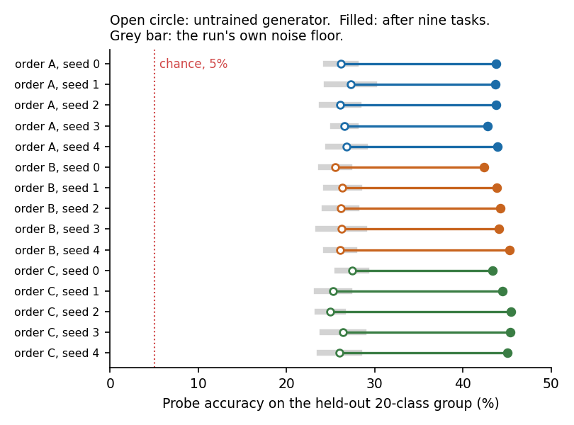
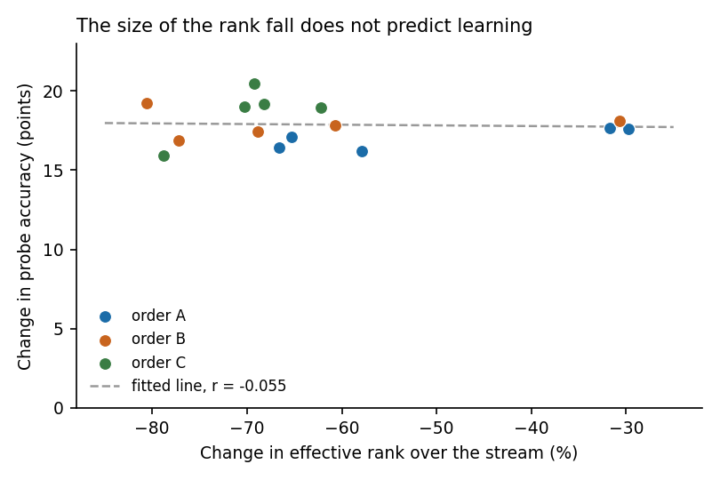
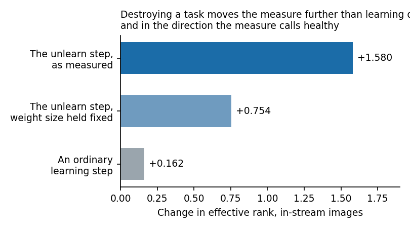
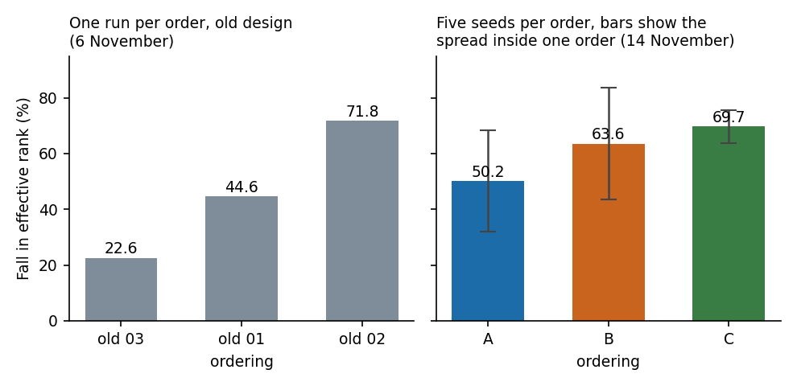

# Rank-based plasticity indicators do not track the ability to learn

Working draft, version 2. Written 14 November 2026.

Every number in this draft appears in one of its tables. Prose never quotes a
value the reader cannot find in a table on the same page. Citations marked "to
verify" need their bibliographic details checked before submission.

**What changed from version 1.** Version 1 was written on an eight-task design
that has since been retired. Its second contribution, a task-order effect on
effective rank, came from one run per order and did not survive five seeds; it
is now a retraction in Section 5.6. Its third contribution, the weight-scale
confound, was measured on one pair of models and is now measured on fifteen.
The new headline is Section 5.2, which could not be written before: the size
of the effective-rank fall carries almost no information about how well the
model then learns a new task.

Table 15 lists every result by which design it was measured on. Section 8
lists what is not yet measured and marks each placeholder.

---

## Abstract

Loss of plasticity in continual learning is often diagnosed with measures read
straight off a network's weights or activations, because they are cheap and
need no extra training. We test three such measures, effective rank, srank and
the dormant-unit fraction, on a hypernetwork continual learner over nine tasks
of twenty classes, with fifteen full runs: three task orderings at five random
seeds each.

The measures move as the literature expects. Effective rank falls on every one
of the fifteen runs. We then measure, on the same fifteen models, whether the
model has in fact lost the ability to learn, by teaching a fresh task code on a
twenty-class group that no run ever sees. It has not. Probe accuracy rises on
all fifteen runs, each clearing its own noise floor, and the size of the rank
fall carries almost no information about the size of the probe gain: the two
correlate at -0.055, which explains 0.3 percent of the spread, and the sign is
the opposite of the one the measure's usual reading predicts.

We give two further results. On fifteen before-and-after pairs, destroying one
task on purpose, until its accuracy sits at chance, raises effective rank in
every pair, and moves it about ten times as far as an ordinary learning step
does, in the direction the measure calls healthy. About half of that rise is
the generated weights becoming smaller rather than the representation
changing; the rest is not. We name the mechanism. Both rank measures divide
scale out of the feature matrix, but the path from weights to features runs
through ReLU and through normalization statistics held fixed, so scale
re-enters through the architecture rather than through the measure.

We do not propose a replacement measure. We give a rescaling control that any
group can run on checkpoints it already holds, in four forward passes with
nothing trained.

---

## 1 Introduction

A network that has learned several tasks in sequence sometimes becomes worse at
learning the next one. Showing that directly is expensive. It means training
something new and counting the result, repeated enough times to clear the
noise.

Measures read straight off the weights or the activations are far cheaper. They
need no extra training and have become common currency in the field. A falling
effective rank or srank, or a rising count of dormant units, is routinely
reported as evidence that capacity was lost.

These measures carry an implicit promise. Each divides out overall scale, so
two numbers are supposed to be comparable across checkpoints, across seeds and
across papers. We tested that promise and it does not hold.

Our setting makes the test unusually clean. A generator writes the complete
weights of a ResNet50 from a short per-task code. The target network stores
nothing between tasks. There is no separately trained classifier head, which is
the explanation one related study gives for its own indicator movement, so that
explanation cannot account for what we see.

### Contributions

1. On fifteen runs we show that the size of the fall in effective rank does
   not predict how well the model then learns an unseen task. The correlation
   is -0.055 (Section 5.2, Table 7, Figure 1).
2. On fifteen before-and-after pairs we show that deliberately destroying a
   task raises effective rank every time, and by about ten times what an
   ordinary learning step moves it (Section 5.3, Tables 10 and 11, Figure 3).
3. We give the mechanism for the weight-scale part of that effect and isolate
   it with a control costing four forward passes and no training
   (Section 5.4).
4. We retract a result from our own earlier draft and show, with the
   measurement that retracts it, why single-run comparisons of these measures
   manufacture effects (Section 5.6, Table 12, Figure 4).

We deliberately propose no replacement measure. Our evidence identifies
confounds and bounds them on one architecture. It does not establish what a
corrected measure should be.

---

## 2 Related work

Loss of plasticity in continual learning is established, and the correlates
usually named for it are weight growth, dead or dormant units, and rank
collapse (Dohare et al., 2024; Lyle et al., 2023, 2024). That work studies full
networks trained from scratch. Our setting differs: the network is written by a
generator at every use and stores nothing between tasks, so weight growth and
rank are properties of the generator rather than of an accumulating parameter
vector.

The measures come from three sources. Effective rank was introduced as a
continuous measure of effective dimensionality (Roy and Vetterli, 2007). srank
was introduced in reinforcement learning as a count of the directions holding
all but a small share of the signal (Kumar et al., 2021). The dormant-unit
fraction was introduced to describe units that stop responding during training
(Sokar et al., 2023). Each normalizes by a quantity computed from the feature
matrix itself, which is what makes cross-run comparison look safe.

Among mitigations, regularizing the weights toward their initial values is the
cheapest published approach and the natural baseline for any method claiming to
restore plasticity (Kumar et al., 2023). We do not evaluate it, and say so in
Section 7.

The unlearning method that supplies our deliberately damaged models reverts the
generated parameters of a forgotten task toward a standard normal
initialization (UnCLe, 2025, to verify). We use it only as a way to produce a
model with known, localized damage. None of our conclusions depends on its
claims.

What is new here is not the measures or the setting but the controls. We are
not aware of prior work that measures the indicators and a direct learning
probe on the same checkpoints at this number of runs, or that separates a
measured change in rank from a simultaneous change in weight scale by direct
rescaling.

---

## 3 Method

### 3.1 Data and task stream

Tiny ImageNet has 200 classes. We split all 200 into ten disjoint groups of
twenty, once, with seed 42, and use the same split in every run. Nothing is
dropped. Nine groups are the learning stream. The tenth, group 9, is never
trained on by any run and is used only as the probe in Section 5.2. A task
therefore has twenty classes, so a model guessing at random scores 5 percent.

Three orderings are used. Six of the nine groups hold the same position in
every ordering. Groups 0, 4 and 8 rotate through positions 1, 5 and 9. That
rotation separates an effect of the order from an effect of one group being
harder than another.

**Table 1. The three task orderings and the held-out group.**

| Ordering | Sequence of groups | Group destroyed in the unlearn step |
| --- | --- | --- |
| order_A | 0, 1, 2, 3, 4, 5, 6, 7, 8 | 0 |
| order_B | 4, 1, 2, 3, 8, 5, 6, 7, 0 | 4 |
| order_C | 8, 1, 2, 3, 0, 5, 6, 7, 4 | 8 |
| (held out) | group 9, never learned by any run | not applicable |

### 3.2 Model and training

**Table 2. Model and training settings, identical in all fifteen runs.**

| Setting | Value |
| --- | --- |
| Target network | ResNet50, 23,541,332 parameters, written fresh at every use |
| Generator | 134,076,432 parameters |
| Per-task code | 32 numbers |
| Chunk codes | 200 |
| Generator hidden sizes | 128, 256, 512 |
| Optimizer | Adam, one learning rate, no parameter groups |
| Learning rate | 5e-4, chosen by the sweep in Table 3 |
| Classes per task | 20 |
| Tasks learned per run | 9 |
| Random seeds per ordering | 5 (seeds 0 to 4) |
| Unlearn burn-in | 100 steps |

The final classifier layer is written by the generator like every other layer.
No classifier is trained separately.

### 3.3 Choosing the learning rate

Five candidate learning rates were run on the first three tasks of order_A at
seed 0, everything else fixed. The rule, written down before the runs, was that
the highest average accuracy over the three tasks wins.

**Table 3. Learning-rate sweep. Accuracy in percent; chance is 5.**

| Step size | Average of the 3 tasks | Task 0 | Task 1 | Task 2 |
| --- | --- | --- | --- | --- |
| 3e-4 | 48.80 | 43.5 | 51.5 | 51.4 |
| **5e-4 (chosen)** | **49.33** | 39.8 | 52.3 | 55.9 |
| 1e-3 | 34.60 | 11.1 | 43.2 | 49.5 |
| 2e-3 | 41.23 | 23.6 | 48.9 | 51.2 |
| 4e-3 | 39.07 | 31.1 | 40.8 | 45.3 |
| **Range, highest minus lowest** | **14.73** | **32.4** | **11.5** | **10.6** |
| **Gap between the top two averages** | **0.53** | | | |

The top two rows of Table 3 are 0.53 points apart, which this study treats as
ordinary run-to-run variation, so 5e-4 and 3e-4 are not really separated. 5e-4
was taken because the rule was fixed in advance. The useful reading of Table 3
is where the step size has its effect: across the five values the first task's
score moves by 32.4 points while the last task, scored right after it is
learned, moves by 10.6. So the step size mostly decides how much earlier work
survives, not how well a new task is learned.

### 3.4 Reading protocol

Readings are taken at ten boundaries: before the first task, after each of the
nine, and once more after the unlearn step. A reading is a single forward pass.
Nothing is trained to take one.

A measure should describe the generator, not whichever task happens to be
loaded. Four choices follow, and all four are held fixed everywhere.

**One code.** Every reading uses the same reference code, drawn once at random
with seed 20261030. It belongs to no task, is never trained, and is identical
across boundaries, seeds and orderings.

**One set of statistics.** A BatchNorm layer keeps the numbers passing through
the network at a sensible size by dividing by a stored mean and spread. Every
reading uses the same stored pair. Evaluation mode is forced, because in
training mode the layer works the mean and spread out from the images in front
of it instead, and a collapsed signal would then be divided by a
correspondingly small spread and come out looking healthy.

**One layer.** Features are the 2048 numbers each image produces at the input
to the target's own final classifier layer, copied out by a forward hook that
alters nothing. Nothing is fitted on top of them.

**The same images.** Each of three image sets contributes 256 images, fixed
across every boundary and every run. `in_stream` holds held-out test images of
the groups being learned. `probe` holds test images of group 9, which no run
sees. `eurosat` holds satellite images from a different dataset. A measure that
moves on all three is describing the generator itself.

The feature matrix is 256 rows by 2048 columns, so no rank count can exceed
256. Every count reported below sits under that ceiling.

### 3.5 Measures

**Effective rank** (Roy and Vetterli, 2007). Take the singular values of the
feature matrix, turn them into shares of their own total, and compute the
exponential of their entropy. In plain words: how many directions the features
really use. It need not be a whole number. A fall during continual training is
a published warning sign of lost plasticity.

**srank** (Kumar et al., 2021), with delta = 0.01. Sort the singular values
from largest down, add them up as a running share of the total, and count how
many are needed to reach 99 percent.

**Dormant units** (Sokar et al., 2023). A site is one place where ReLU is
applied. A unit's score is its mean absolute activation divided by the mean
over all units at that site. A score near 0 is a unit that has stopped
contributing. Cut-offs of 0.01, 0.025 and 0.1 are recorded.

Both rank measures divide the singular values by their own sum, so rescaling
the feature matrix leaves them unchanged. Section 5.4 tests whether that
invariance survives the path from weights to features.

### 3.6 The direct probe

The probe asks the question the indicators are used as a proxy for: can this
model still learn something new?

It takes a finished model, freezes the generator's learned state, and teaches a
fresh task code on group 9, which no run has seen. It then reads test accuracy.
The probe forks and discards: the session checks after every probe that the
model is bit-for-bit unchanged, and stops if it is not.

At each point, three learning rates are tried, the best is chosen on a
validation split that is separate from the test split, and the whole thing is
repeated eleven times. The spread across those repetitions gives each run its
own noise floor. A change counts only if it is larger than that floor.

### 3.7 The unlearn step

After the nine tasks, each run destroys one group on purpose, using the
published unlearning method with a 100-step burn-in. Table 1 gives which group
each ordering destroys. This produces a model with damage that is known,
deliberate and localized, which is the sharpest available test of whether a
measure detects damage.

---

## 4 The streams themselves

Fifteen runs finished: three orderings at five seeds each.

**Table 4. The fifteen streams. Accuracy is the mean over the nine tasks at the
end of the stream, in percent; chance is 5.**

| Ordering | Runs | Mean accuracy | Spread, best minus worst | Standard deviation |
| --- | --- | --- | --- | --- |
| order_A | 5 | 40.18 | 7.03 | 2.89 |
| order_B | 5 | 41.59 | 8.09 | 3.07 |
| order_C | 5 | 39.87 | 3.87 | 1.42 |
| **Widest gap between ordering averages** | | **1.72** | | |
| **Typical disagreement between seeds of one ordering** | | **2.46** | | |
| **Accuracy of the destroyed group after the unlearn** | 15 | **5.00** | **0.00** | **0.00** |

The widest gap between ordering averages in Table 4 is 1.72 points, against
about 2.46 points of disagreement between the seeds of a single ordering. On
accuracy the three orderings are the same. That matters for Section 5.6: if one
ordering had finished far ahead, an indicator comparison between orderings
would be reading two different models rather than two different orders.

The unlearn step landed on exactly 5.00 percent accuracy for the destroyed
group in all fifteen runs, which is chance for twenty classes. The damage in
Section 5.3 is therefore not in doubt.

A pre-set stability target asked five seeds to finish within 3 points of each
other. Table 4 shows 7.03, 8.09 and 3.87, so the target fails as written. We
report this rather than retune, for two reasons given in Section 7.

---

## 5 Results

### 5.1 The indicators fall, as the literature expects

**Table 5. Change from boundary 0 to boundary 9, averaged over the five seeds
of each ordering, on the in_stream images.**

| Ordering | Effective rank | Spread across its own five seeds |
| --- | --- | --- |
| order_A | -50.2% | 18.1 |
| order_B | -63.6% | 20.0 |
| order_C | -69.7% | 6.0 |
| All fifteen | -61.2% | 17.0 |

Effective rank falls on every one of the fifteen runs. Dormant units rise on
every run of every ordering. Taken at face value, Table 5 is the published
signature of lost plasticity, measured at five seeds per ordering rather than
one.

Everything that follows asks whether that signature means what it is taken to
mean.

### 5.2 The size of the fall does not predict the ability to learn

This is the central result. It is measured on the same fifteen models as
Table 5, at the same two boundaries.

**Table 6. The direct probe on group 9, which no run learns. Chance is 5
percent. "Floor" is the run's own repetition noise. The last column repeats
that run's change in effective rank over the same two boundaries.**

| Run | Probe at t = 0 | Probe at t = 9 | Change | Floor | Change / floor | Effective rank |
| --- | --- | --- | --- | --- | --- | --- |
| order_A seed 0 | 26.13% | 43.72% | +17.59 | 1.70 | 10.3 | -29.8% |
| order_A seed 1 | 27.25% | 43.65% | +16.40 | 2.72 | 6.0 | -66.6% |
| order_A seed 2 | 26.06% | 43.75% | +17.68 | 2.10 | 8.4 | -31.7% |
| order_A seed 3 | 26.55% | 42.76% | +16.22 | 1.26 | 12.9 | -57.9% |
| order_A seed 4 | 26.78% | 43.90% | +17.12 | 2.07 | 8.3 | -65.3% |
| order_B seed 0 | 25.50% | 42.39% | +16.89 | 1.62 | 10.4 | -77.2% |
| order_B seed 1 | 26.35% | 43.81% | +17.45 | 1.91 | 9.1 | -68.9% |
| order_B seed 2 | 26.15% | 44.24% | +18.09 | 1.81 | 10.0 | -30.7% |
| order_B seed 3 | 26.21% | 44.03% | +17.82 | 2.63 | 6.8 | -60.7% |
| order_B seed 4 | 26.05% | 45.28% | +19.24 | 1.60 | 12.0 | -80.6% |
| order_C seed 0 | 27.41% | 43.31% | +15.90 | 1.67 | 9.5 | -78.8% |
| order_C seed 1 | 25.27% | 44.45% | +19.18 | 1.82 | 10.5 | -68.2% |
| order_C seed 2 | 24.95% | 45.44% | +20.49 | 1.48 | 13.8 | -69.2% |
| order_C seed 3 | 26.39% | 45.36% | +18.97 | 2.31 | 8.2 | -62.2% |
| order_C seed 4 | 26.01% | 45.04% | +19.03 | 2.27 | 8.4 | -70.3% |
| **Mean** | **26.20%** | **44.08%** | **+17.87** | **1.93** | | **-61.2%** |
| Standard deviation | 0.66 | 0.92 | 1.30 | | | 17.0 |
| Lowest | 24.95% | 42.39% | +15.90 | 1.26 | 6.0 | -30.7% |
| Highest | 27.41% | 45.44% | +20.49 | 2.72 | 13.8 | -80.6% |

Probe accuracy rose past the run's own floor in 15 of 15 runs. It fell past the
floor in none. Figure 2 shows every row of Table 6 as a line from its starting
point to its end point, with the floor drawn on the start.



**Figure 2.** Every row of Table 6 drawn as a line. The open circle is the
untrained generator, the filled circle is after nine tasks, and the grey bar on
the start is that run's own noise floor. The dotted line is chance at 5
percent.

So the model learns an unseen twenty-class group better after nine tasks than
before any training, on every run, while the indicators say its representation
collapsed.

The stronger statement is about the sizes, and it needs all fifteen runs.

**Table 7. How the rank fall relates to the probe gain, across the fifteen runs
of Table 6.**

| Quantity | Value |
| --- | --- |
| Range of the effective-rank fall | 30.7% to 80.6%, a factor of 2.6 |
| Range of the probe change | +15.90 to +20.49 points |
| Correlation between the two | -0.055 |
| Share of the probe spread it explains | 0.3% |
| Slope, probe points per 1 percent of extra rank fall | -0.004 |

If effective rank reported a lost ability to learn, the runs that lost most of
it would learn the new group worst. Table 7 says they do not. The correlation
is almost exactly zero, and what little sign it has points the other way: more
rank lost goes with slightly more learned, not less. Figure 1 plots the fifteen
runs.



**Figure 1.** Each point is one of the fifteen runs of Table 6. The horizontal
axis is how much effective rank fell over the stream; the vertical axis is how
much better the model then learned the held-out group. If the measure reported
a lost ability to learn, points on the left would sit low. The fitted line is
flat, with the correlation given in Table 7.

Read coarsely by ordering, the two quantities move against each other, which is
the same point:

**Table 8. The two measurements by ordering, from Tables 5 and 6.**

| Ordering | Probe change, mean | Effective rank change, mean |
| --- | --- | --- |
| order_A | +17.00 | -50.2% |
| order_B | +17.90 | -63.6% |
| order_C | +18.71 | -69.7% |

The ordering with the largest rank fall in Table 8 has the largest probe gain.
With a probe spread of 1.30 points from Table 6, those three means are not far
apart, so Table 8 is reported as the direction of the data rather than as an
ordering effect. Section 5.6 explains why we are careful here.

#### An unplanned repeat measurement

Boundary 0 is the untrained generator, rebuilt from the seed rather than loaded
from a file, and the probe's own seed depends only on the task and the
repetition, not on the ordering. So each seed's boundary-0 reading in Table 6
was taken three times, once per ordering, on a configuration that should be
identical.

**Table 9. The same seed's boundary-0 probe reading, taken once under each
ordering. Values are the t = 0 column of Table 6, regrouped.**

| Seed | order_A | order_B | order_C | Spread |
| --- | --- | --- | --- | --- |
| 0 | 26.13% | 25.50% | 27.41% | 1.91 |
| 1 | 27.25% | 26.35% | 25.27% | 1.98 |
| 2 | 26.06% | 26.15% | 24.95% | 1.20 |
| 3 | 26.55% | 26.21% | 26.39% | 0.34 |
| 4 | 26.78% | 26.05% | 26.01% | 0.77 |

The three readings are not identical, so something in the pipeline is not
reproducible. Either the GPU arithmetic does not repeat exactly, or the
ordering reaches the starting generator through the configuration. Which of the
two it is has not been established. **Placeholder: one cheap check settles
this, and it should be run before submission.**

What Table 9 does establish is a bound that costs nothing. Repeating a
nominally identical measurement moves it by at most 1.98 points. The effect
measured in Table 6 is +17.87 points on average, so the effect is about nine
times the worst case in Table 9.

### 5.3 The indicators call a deliberately broken model healthy

The sharpest single demonstration. Each of the fifteen runs destroys one group
on purpose after its nine tasks, and the destroyed group sits at exactly 5.00
percent accuracy afterwards, which is chance (Table 4). That is the damage,
and it is not in dispute: the group the model could classify it now cannot.

Four readings are taken per pair, all forward passes, nothing trained: the
model at the end of the stream, the model after the unlearn, the post-unlearn
weights multiplied by one constant so their norm matches the earlier model, and
the earlier weights shrunk to the post-unlearn norm.

**Table 10. The unlearn step across all fifteen before-and-after pairs,
effective rank on the in_stream images.**

| | Average change | Same direction in |
| --- | --- | --- |
| What the unlearn did | **+1.580** | 15 of 15 runs |
| What is left after the weight size is held fixed | **+0.754** | 14 of 15 runs |
| Share the weight size explains | **52%** | |

Rank going up is the direction these measures call healthy. It went up in every
run, on a model that had just had a task destroyed. The same pattern holds on
the probe images, on EuroSAT, and on srank.

Table 10 on its own does not say whether +1.580 is large. Table 11 does.

**Table 11. The unlearn step against an ordinary learning step, same fifteen
runs, effective rank on the in_stream images.**

| Step | Change in effective rank | How many such steps | Times an ordinary step |
| --- | --- | --- | --- |
| An ordinary learning step, tasks 2 through 9 | 0.162 in typical size | 120 | 1.0 |
| The unlearn step, as measured | +1.581 | 15 | **9.7** |
| The unlearn step, weight size held fixed | +0.754 | 15 | **4.7** |

From Table 11, the unlearn moves effective rank about 9.7 times as far as an
ordinary learning step, in the opposite direction, and still 4.7 times as far
after the weight size is held fixed. Figure 3 draws the three rows.



**Figure 3.** The three rows of Table 11. Destroying a task moves effective
rank further than learning does, and in the direction the measure calls
healthy.

A measure that barely notices nine tasks of learning, and then jumps about ten
times further in the healthy direction when a task is destroyed, is not
reporting damage.

#### A correction to our own earlier reporting

Version 1 of this draft ran this control on a single pair of models from the
retired design and reported that the weight size carried about two thirds of
the rise, which left a residual too small to call a signal. Across fifteen
pairs the share is 52 percent in Table 10, not two thirds, and the residual is
+0.754, which Table 11 puts at 4.7 ordinary steps. One pair could not tell the
difference.

A second correction concerns the statistic, not the data. The share was first
computed by averaging each run's own ratio of residual to raw change. That
divides by each run's own change, and some of those changes are near zero,
which sends a single run's share far outside the range and drags the average
with it. The ratio of the averages, 52 percent in Table 10, does not have that
problem and is what we report. No reading was wrong; only the summary line was
the wrong statistic.

### 5.4 The mechanism

Both rank measures divide the singular values by their own sum, so multiplying
the whole feature matrix by a constant cannot move them. That is why they look
safe to compare across models.

The weights do not reach the features directly. They pass through ReLU, which
zeroes negatives, and through batch statistics held fixed that do not rescale
with the weights. Neither step preserves scale. Making the generated weights
smaller pushes units across their firing threshold and reshapes the spectrum.

So scale re-enters through the architecture rather than through the measure. On
this architecture, effective rank and srank are partly a readout of how large
the generated weights are, and two models whose weight norms differ by several
percent cannot be compared on these measures alone.

The mechanism predicts where the problem bites, and that prediction is
testable. It should bite hardest where the norm moves fastest. The unlearn step
moves the norm much further in its 100 steps than a learning task does, and in
the opposite direction, which is exactly where Table 10 finds the largest
effect. **Placeholder: the per-run norm changes for the fifteen pairs are
recorded and should be tabulated here, so this sentence can carry a number.**

**Placeholder.** The per-arm absolute readings for the fifteen-pair control are
recorded but not yet tabulated here. Version 1 showed them for one pair.
Tables 10 and 11 give the aggregate, which is what the claim rests on.

### 5.5 A control in the other direction

A measure that moved for no reason would be a different problem from a measure
that moves for the wrong reason. The random-direction control rules the first
out. Taking each stream's starting generator and pushing it the same distance
in directions chosen by nothing does not reproduce the fall.

So the measure is reading something real about the model. It is just not
reading the ability to learn.

**Placeholder: this control was run on the retired design and its numbers are
not reproduced here. Re-running it on the fifteen current streams is cheap,
because it trains nothing. Table 15 records its status.**

### 5.6 Retraction: the task-order effect

Version 1's second contribution was that the order of the tasks alone changes
the reported fall by a large factor while the generator travels the same
distance. That was measured with one run per ordering. It does not survive five
seeds.

**Table 12. The same measurement at one run per ordering and at five.**

| | Fall in effective rank | Spread across seeds |
| --- | --- | --- |
| Retired design, one run each, three orderings | 22.6%, 44.6%, 71.8% | not measurable |
| Revised design, order_A, five seeds | -50.2% | 18.1 |
| Revised design, order_B, five seeds | -63.6% | 20.0 |
| Revised design, order_C, five seeds | -69.7% | 6.0 |
| Gap between ordering averages, in standard errors | 1.36 | |

The five seeds of a single ordering vary by about as much as the three
orderings differed from each other in the old reading. A gap of 1.36 standard
errors is not a difference. Figure 4 puts the two panels side by side.



**Figure 4.** Table 12 in two panels. Left: one run per ordering on the
retired design, which looked like a large order effect. Right: five seeds per
ordering on the revised design, where the spread inside one ordering covers the
gap between orderings.

Every measure was compared between every pair of orderings. Table 13 gives the
widest gap each measure reached.

**Table 13. Widest gap between two ordering averages, in standard errors, at
five seeds per ordering. The usual bar at this number of runs is 2.3.**

| Measure | Widest gap | Reading |
| --- | --- | --- |
| srank, EuroSAT images | 2.50 | at the bar |
| srank, probe images | 2.43 | at the bar |
| srank, in_stream images | 2.36 | at the bar |
| Effective rank, all three image sets | 1.36 to 1.37 | no difference |
| Distance moved, weight norm, angle | 0.78 to 1.19 | no difference |
| Dormant units, all three cut-offs | 0.64 to 0.90 | no difference |
| Measures compared | 21 | |
| Pairs of orderings | 3 | |
| Comparisons in total | 63 | |

srank is the only row of Table 13 at the bar, and we do not report it as a
finding. The three image sets are one model read three ways rather than three
independent tests, so those three rows are one marginal result and not three
agreeing ones. And at a bar of 2.3, one or two of 63 comparisons clear it by
chance alone. srank is suggestive and needs its own test.

**What we do and do not claim from this.** We claim that our own earlier
single-run result was an artifact of the seed, and we show the measurement that
establishes it. We make no claim about what seed counts other groups use. We
have not checked, and the one comparable study we hold runs two seeds and
labels its own numbers provisional.

---

## 6 Discussion

Taken together these results say that a number from one of these measures is
not self-describing. Mixed in with whatever the representation is doing, it
carries the random seed and the scale of the weights, and in our earlier draft
it appeared to carry the task order too. None of those is reported alongside
the measure as current practice stands.

The sharpest case is the model with a task destroyed. Its accuracy on that
group sat at chance, the damage was localized, and the measures moved the way
they treat as healthy, in every one of fifteen runs. We do not claim the model
became healthier. The point is narrower and harder to argue with: on models
where damage was certain, these measures did not detect it, and about half
their movement is a change in weight scale that carries no information about
the representation.

The result we would most like a reader to take away is Table 7. It is not that
the measures move when they should not. It is that when they move by very
different amounts, those amounts tell you almost nothing about the quantity
they stand in for. A run can lose a third of its effective rank or four fifths
of it and learn the held-out group equally well.

Three practices would make the confounds visible at almost no cost.

**Report the weight norm beside the rank.** It costs nothing to compute, and it
is the quantity that moves these measures without touching the representation.
A rank change reported without it cannot be interpreted.

**Run the rescaling control before comparing two checkpoints.** Multiply one
checkpoint's weights by a single constant so its norm matches the other, then
read the measure again. Four forward passes, no training, no GPU. Whatever
survives that is the part worth discussing.

**Do not compare absolute levels across single runs.** Table 12 is what happens
when you do.

How far this generalizes is the open question, and it has a cheap answer. The
two mechanisms in Section 5.4, ReLU and fixed normalization statistics, are
present in most modern architectures, which suggests the confound is a property
of the measure rather than of hypernetworks. But a generator writing a full
ResNet50 from 32 numbers is unusual enough that the objection is fair. The test
that settles it needs no training: take two checkpoints from any continually
trained model, rescale one to match the other's norm, and read the measure
again.

We deliberately do not propose a corrected measure. Our evidence identifies
confounds and bounds them on one architecture. Proposing a replacement without
testing it would repeat the error we are describing.

---

## 7 Limitations

All results come from one architecture, in which a generator writes a full
ResNet50 from 32 numbers. Nothing here establishes that the confound appears
outside this setting.

The probe in Section 5.2 uses a group from the same dataset as the stream, so
ordinary forward transfer is not ruled out as part of the rise. The probe also
trains a fresh task code on a frozen generator, so it measures what the
generator can be asked to do, not what the stream model does unaided.

The probe reads two endpoints. The models for a midpoint reading exist and have
been kept, but the midpoint has not been measured, so the two endpoints could
in principle hide a dip in the middle. On the retired design a five-point curve
found no such dip.

Table 9 shows that a nominally identical measurement does not repeat exactly,
and the cause is not established.

The stability target in Section 4 fails as written. We report this rather than
retune, for two reasons.

The first is that the target is written as a range, and a range widens as runs
are added. Table 14 shows what the same 3-point target demands of the
underlying spread at different numbers of runs.

**Table 14. What a 3-point range target implies for the standard deviation,
using the expected range of n draws.**

| Runs | Largest standard deviation that still passes |
| --- | --- |
| 3 | 1.77 |
| 5 | 1.29 |
| 10 | 0.97 |

So a study could pass the target in Table 14 by running fewer seeds, which is
the opposite of what the target is for.

The second reason is that accuracy is not the quantity this paper compares.
The spread that matters is the one in Tables 5 and 6, and it is reported
there.

We do not evaluate regularization toward initial values, which is the natural
baseline for methods claiming to restore plasticity. No corrected or
scale-invariant replacement measure is proposed.

---

## 8 What is not yet measured

**Table 15. Every result in this draft by the design it was measured on.**

| Result | Section | Design | Runs |
| --- | --- | --- | --- |
| The indicators fall over the stream | 5.1 | revised | 15 |
| Probe accuracy rises, and the rank fall does not predict it | 5.2 | revised | 15 |
| The unlearn raises effective rank | 5.3 | revised | 15 pairs |
| Weight scale explains about half of that | 5.3 | revised | 15 pairs |
| Mechanism | 5.4 | argument, plus 5.3 | |
| Random-direction control | 5.5 | **retired** | 3 |
| Task-order retraction | 5.6 | revised | 15 |
| Fitting random labels | not written | **retired** | 3 |
| Speed of learning an unseen task | not written | **retired** | 2 |
| Curvature at a trained code | not written | **retired** | 2 |
| Learning after deliberate damage | not written | **retired** | 3 |
| Effective rank converging across seeds | not written | **retired** | 3 |

Rows marked "retired" were measured on an eight-task design of ten classes each
that Section 3 no longer describes, on checkpoints the current class split
cannot load. Their numbers are not quoted in this draft, because a number from
a design the method section does not describe should not be in the results.

Six direct measurements in total say the model keeps its ability to learn.
Section 5.2 is the first of them re-established on the current design. The rest
are placeholders. Four of them are cheap: the random-label arm and the
curvature arm fork and discard, learning speed can be read from data the probe
session already saved, and the random-direction control trains nothing at all.

**Placeholder: the effective-rank convergence result.** On the retired design,
three runs that started far apart in effective rank ended close together, which
made the size of the fall largely a statement about the random initialization.
The revised runs record the same quantity at boundary 0 and boundary 9, so this
can be recomputed from records already in storage with no new runs. If it
replicates it belongs in Section 5.1, because it would explain part of the
spread in Table 5.

**Placeholder: boundary 4.** The midpoint models are kept for all fifteen runs.
Probing them adds 495 probe runs to the 990 already done and would close the
limitation in Section 7 about a hidden dip.

**Placeholder: Table 9's cause.** One cheap check decides whether the
non-repeating reading is GPU arithmetic or the ordering reaching the starting
generator.

**Placeholder: the srank test.** Section 5.6 leaves srank at the bar inside a
family of 63 comparisons. A dedicated test, stated in advance, would settle it
either way.

---

## How this draft is built

Figures are built by `scripts/build_paper_figures.py`. Every value in that
script is copied from a table above, so any point on any figure can be checked
against a table.

`paper-draft.docx` beside this file is generated, not edited. Rebuild it after
any change here, from the repository root:

```
tail -n +2 docs/plasticity/paper-draft.md > /tmp/body.md && pandoc /tmp/body.md -o docs/plasticity/paper-draft.docx --resource-path=docs/plasticity --metadata title="Rank-based plasticity indicators do not track the ability to learn"
```

The first line is dropped because the title comes from the metadata instead,
which keeps Word from showing it twice.

---

## References

Dohare, S., Hernandez-Garcia, J. F., Lan, Q., Rahman, P., Mahmood, A. R., and
Sutton, R. S. Loss of plasticity in deep continual learning. Nature,
632:768-774, 2024.

Kumar, S., Marklund, H., and Van Roy, B. Maintaining plasticity in continual
learning via regenerative regularization. arXiv:2308.11958, 2023.

Kumar, A., et al. srank and the implicit under-parameterization of deep
networks, 2021. [full citation to verify]

Lyle, C., Zheng, Z., Nikishin, E., Avila Pires, B., Pascanu, R., and Dabney, W.
Understanding plasticity in neural networks. In ICML, 2023.

Lyle, C., Zheng, Z., Khetarpal, K., van Hasselt, H., Pascanu, R., Martens, J.,
and Dabney, W. Disentangling the causes of plasticity loss in neural networks.
In CoLLAs, 2024.

Roy, O. and Vetterli, M. The effective rank: a measure of effective
dimensionality, 2007. [full citation to verify]

Sokar, G., et al. The dormant neuron phenomenon in deep reinforcement learning,
2023. [full citation to verify]

UnCLe: unified continual learning and unlearning with hypernetworks. Preprint,
2025. [full citation to verify; a journal version exists in MLJ]
