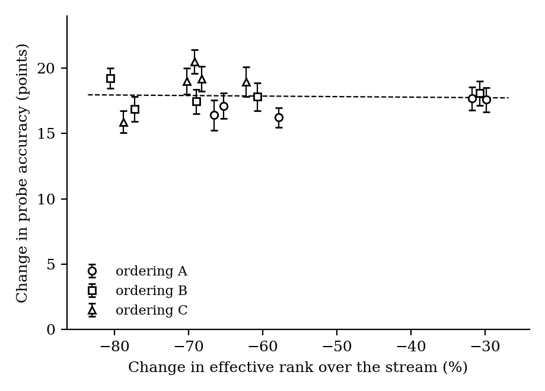

# Rank-based plasticity indicators and directly measured learning ability in a hypernetwork continual learner

Skeleton, 15 November 2026. Title, abstract and section plan only. Each
section below states what it will contain, which experiment supplies it, and
which notebook produced the data. No results are written yet.

Two alternative titles are recorded in the paper plan.

## Abstract

A network that learns tasks in sequence can become worse at learning the next
one. Detecting that loss matters, but measuring it directly means training the
network on a further task, which is costly enough that it is rarely repeated.
Practitioners therefore rely on measures read from the weights or activations
alone, with no training. Three are in wide use: effective rank, srank, and the
fraction of dormant units. Each is normalized so that overall scale cannot
affect it, which is taken to mean that two readings may be compared directly.

How closely these measures follow the quantity they stand for is largely
untested, because in the architectures they are applied to the direct
measurement is expensive. A hypernetwork removes that cost. The generator can
be frozen and a short task code trained in its place, so learning ability can
be measured many times rather than once.

We run fifteen streams of nine 20-class Tiny ImageNet tasks, as three task
orderings with five random seeds each, holding a tenth group of classes out of
training. At the start and the end of every stream we train a fresh task code
on that held-out group, record its accuracy, and discard the code, so the
measurement cannot alter the model it measures.

Across the fifteen runs the size of the indicator change does not account for
the differences in measured learning, and its sign is the opposite of the one
the usual reading predicts. The indicators fall in every run while measured
learning ability rises in every run. A model with one task deliberately
reduced to chance accuracy moves the indicators in the direction they report
as healthy, and holding the weight scale fixed removes about half of that
movement. We also retract an earlier single-run result on task ordering, which
the five-seed measurement does not support.

In this setting, a reading of these measures is not evidence about the ability
to learn. The weight-scale result shows where the failure comes from: both
rank measures reach the generated weights along a path that their own scale
normalization does not cover, so a comparison between models of different
weight scale is in part a comparison of those scales.

---

# 1 Introduction

**Contents.** The problem of diagnosing lost plasticity without training.
The implicit promise of a scale-normalized measure. Why a hypernetwork is a
useful test setting: the generator can be frozen and a task code trained in
its place, which gives a direct measurement at a cost low enough to repeat.
Statement of contributions.

**Contributions to list.** One per result that is measured on the present
design. Draft wording to be settled after Section 5 is written, so the claims
and their evidence are fixed first.

**Source.** No new data. Written from Sections 5 and 6.

**Status.** To write last.

---

# 2 Related work

**Contents.** Loss of plasticity in continual learning, and the correlates
usually named for it. The three measures and their original sources: effective
rank (Roy and Vetterli, 2007), srank (Kumar et al., 2021), dormant units
(Sokar et al., 2023). The unlearning method that supplies the damaged model
(UnCLe). What is new here, which is the controls rather than the measures or
the setting.

**Carry over.** Section 2 of the version 1 draft can be reused with small
changes. The measures and their sources have not changed.

**Source.** Literature only.

**Status.** Mostly carried over from version 1.

---

# 3 Method

## 3.1 Model and task stream

**Contents.** The hypernetwork and the ResNet50 it generates, with parameter
counts. The 32-number task code. The class split: 200 Tiny ImageNet classes in
10 disjoint groups of 20, nine learned and group 9 held out. Chance accuracy
of 5 percent. Why the eight-task, ten-class split used in version 1 was
replaced.

**Source.** Configuration in `uncle/config.py`. Design recorded in the
trajectory page for 12 November 2026.

**Status.** To write. Replaces Section 3.1 of version 1, which describes the
retired design.

## 3.2 Training and the learning-rate sweep

**Contents.** Optimizer, step counts, batch size, and how the learning rate
was chosen. Why a sweep was needed before the streams were run.

**Experiment.** Learning-rate sweep.

**Notebook.** `43_learning_rate_sweep.ipynb`.

**Status.** To write. Belongs in Method, not in Results.

## 3.3 Reading protocol

**Contents.** The four choices that make a reading describe the generator
rather than whichever task is loaded: one reference code (seed 20261030),
fixed BatchNorm statistics with the model in evaluation mode, one layer (the
2048 features at the input to the final classifier), and three fixed image
sets of 256 images each. What the three image sets are and why they differ in
distance from the training distribution.

**Carry over.** Section 3.2 of version 1 is correct as written and applies
unchanged to the present design.

**Status.** Carried over from version 1.

## 3.4 Measures

**Contents.** Definition of effective rank, srank with delta = 0.01, and the
dormant-unit fraction at cut-offs 0.01, 0.025 and 0.1. The normalization each
one applies, and what that normalization is taken to guarantee.

**Carry over.** Section 3.3 of version 1.

**Status.** Carried over from version 1.

## 3.5 The direct probe

**Contents.** The procedure: freeze the generator, train a fresh task code on
the held-out group, record accuracy, discard the code. The learning-rate
choice within the probe, made on a validation split. The eleven repetitions
and the noise floor taken from their spread. Why the measurement cannot alter
the model it measures.

**Experiment.** Experiment 2 in the explainer.

**Notebook.** `47_probe_on_the_revised_streams.ipynb`. Earlier version on the
retired design: `38_matched_probe.ipynb`.

**Status.** To write. New section; version 1 had no equivalent.

## 3.6 The unlearning step

**Contents.** What UnCLe does to the generated parameters of a forgotten task,
the 100-step burn-in, and how the resulting model is read. The rescaling
control: four readings per pair, so that the part of the indicator movement
caused by weight scale can be separated from the rest.

**Experiment.** Experiment 4 in the explainer.

**Notebook.** `46_rescaling_control.ipynb`.

**Status.** To write.

---

# 4 Experimental design

## 4.1 Orderings and seeds

**Contents.** The three orderings, with the table of partition indices. Which
six groups are fixed and which three rotate. Five seeds per ordering, fifteen
streams in total. Why five seeds, and what the 13 November spread reading
showed about the number of runs a single comparison needs.

**Experiments.** The stream runs.

**Notebooks.** `44_order_A_five_seeds.ipynb`, `45_orders_B_and_C.ipynb`.

**Table to include.** The three orderings by partition index. Carried over in
form from Table 1 of version 1, with new values.

**Status.** To write.

## 4.2 What each measurement contributes

**Contents.** A short table mapping each result section to the experiment and
notebook behind it, and to the design it was measured on. This is the section
that keeps the retired-design results visibly separate from the present ones.

**Status.** To write.

---

# 5 Results

## 5.1 Indicator trajectories over the stream

**Contents.** How effective rank, srank and the dormant-unit fraction change
from boundary 0 to boundary 9, across the fifteen runs. Per-ordering means and
the spread between seeds within an ordering. The ratio of the change to that
spread, which is the quantity that decides how many runs a comparison needs.

**Experiment.** Experiment 1 in the explainer.

**Notebooks.** `44_order_A_five_seeds.ipynb`, `45_orders_B_and_C.ipynb`.

**Tables to include.** Per-run change in effective rank, fifteen rows. All
three measures with their change, seed spread, and the ratio between them.
The dormant-unit values must appear in a table; version 2 asserts their
direction in prose with no table behind it.

**Figure.** One bar per run, showing that every run falls and by how much.

**Status.** To write.

## 5.2 Directly measured learning ability at the stream endpoints

**Contents.** Probe accuracy at boundary 0 and boundary 9 for each of the
fifteen runs, with each run's own noise floor. The comparison between the
change and that floor.

**Experiment.** Experiment 2 in the explainer.

**Notebook.** `47_probe_on_the_revised_streams.ipynb`.

**Table to include.** Fifteen rows: ordering, seed, start, end, change, floor.

**Figure.** Start and end per run, with the noise floor marked and chance
drawn in.

**Status.** To write.

## 5.3 Relation between indicator change and measured learning

Section 5.1 reports that every indicator moves in the direction associated
with lost plasticity, and Section 5.2 reports that measured learning ability
rises over the same span. Those results concern the direction each quantity
moves. This section asks the weaker question that would still leave the
indicators useful: whether the size of the indicator change tracks the size of
the change in measured learning.

The question can be asked here because both quantities vary across the
fifteen runs. Table 6 gives their ranges.

Table 6. Change from boundary 0 to boundary 9 on the in_stream images,
across the fifteen runs. Indicator changes are a percent of the value at
boundary 0; the probe change is in accuracy points.

| Quantity | Mean | Lowest | Highest |
| --- | --- | --- | --- |
| Effective rank | -61.20% | -80.58% | -29.81% |
| srank | -63.19% | -97.92% | -15.04% |
| Dormant units, cut-off 0.01 | +116.22% | +50.90% | +174.51% |
| Dormant units, cut-off 0.025 | +95.37% | +44.88% | +142.61% |
| Dormant units, cut-off 0.1 | +62.45% | +34.67% | +86.63% |
| Probe accuracy | +17.87 | +15.90 | +20.49 |

The change in effective rank varies by a factor of 2.7 between the smallest
and the largest. If the indicators report the ability to learn, the runs whose
indicators moved furthest should be the runs that gained least.

Each measure carries a predicted direction for this relation. Effective rank
and srank are read so that a larger fall means less remaining ability to
learn, so a run whose rank fell less should gain more, which makes the
predicted correlation positive. Dormant units are read the other way, so their
predicted correlation is negative. Table 7 gives the measured values.

Table 7. Correlation between each indicator's change and the probe's change,
over the fifteen runs. r is the Pearson correlation and r squared is the share
of the between-run variation in the probe change that it accounts for.

| Measure | Predicted sign | r | r squared | Sign as predicted |
| --- | --- | --- | --- | --- |
| Effective rank | positive | -0.054 | 0.3% | no |
| srank | positive | -0.178 | 3.2% | no |
| Dormant units, cut-off 0.01 | negative | +0.129 | 1.7% | no |
| Dormant units, cut-off 0.025 | negative | +0.125 | 1.6% | no |
| Dormant units, cut-off 0.1 | negative | +0.112 | 1.3% | no |

No measure matches its predicted direction, and the largest share of the
variation any of them accounts for is 3.2 percent. Figure 1 shows the
effective-rank row of Table 7.

Figure 1. Change in effective rank against change in probe accuracy, one
point per run. Error bars are each run's own standard error on the probe
change. The dashed line is the least-squares fit.

A failed correlation is only informative if the quantity it fails to predict
varies for real reasons rather than from measurement noise. If the probe
change were the same in every run apart from noise, no predictor could
correlate with it and Table 7 would say nothing about the indicators.

The probe was repeated eleven times at each point of each run, so this can be
measured rather than assumed. The spread of those repetitions gives the noise
the probe adds to one run's reported change, and the spread of the reported
changes across runs gives the total. The difference between the two is real
variation between models.

Table 8. Where the between-run spread in the probe change comes from. All
values are standard deviations in accuracy points, except the last three rows.

| Quantity | Value |
| --- | --- |
| Mean probe change | +17.87 |
| Spread of the change between runs | 1.300 |
| Part the probe's own repetition noise produces | 0.953 |
| Part that is real difference between models | 0.883 |
| Share of the between-run spread that is real | 46.2% |
| Largest correlation that share permits | 0.680 |
| Largest correlation measured in Table 7 | 0.178 |

Just under half of the between-run spread in the probe change is real
difference between models, so there is something for the indicators to
predict. An imperfectly measured outcome does limit how large a correlation
any predictor can show, and that limit is the square root of the real share,
which is 0.680 here. Every value in Table 7 is far below that limit. Every
value is also far below 0.514, which is the correlation that fifteen runs
would need for the relation to be distinguishable from zero at the five
percent level.

Within this design, then, the size of the indicator change carries no usable
information about how much the ability to learn changed. The failure is not
only that the relation is weak. In all five measures its direction is the
opposite of the one the usual reading requires.

Appendix A gives the per-run values behind Tables 6 and 7.

## 5.4 Indicator response to a deliberately damaged model

**Contents.** Accuracy of the destroyed group after unlearning. The movement
of each indicator, and its direction relative to the direction the indicator
reports as healthy. The comparison against the movement produced by an
ordinary learning step.

**Experiment.** Experiment 4 in the explainer.

**Notebook.** `46_rescaling_control.ipynb`.

**Tables to include.** Accuracy after unlearning against chance. Indicator
movement for an ordinary step and for the unlearn, with the ratio between
them. srank needs a numeric row; the 14 November record gives only its
direction, so the number must be read from the stored records before this
section is written.

**Figure.** The three movements as a bar chart on one axis.

**Status.** To write. One number still to be extracted.

## 5.5 The contribution of weight scale

**Contents.** The mechanism: both rank measures divide the singular values by
their sum, so rescaling the feature matrix cannot move them, but the path from
generated weights to features passes through ReLU and through fixed batch
statistics, so a change in weight scale does move them. The measured share of
the unlearn movement that weight scale accounts for, across fifteen pairs.
The earlier single-pair figure and why it did not replicate.

**Experiment.** Experiment 4 in the explainer, rescaling arm.

**Notebook.** `46_rescaling_control.ipynb`.

**Table to include.** Movement as measured, movement with weight scale held
fixed, and the share explained.

**Status.** To write.

## 5.6 Comparison across task orderings, and a retraction

**Contents.** The 6 November single-run result on task ordering, stated
plainly. The same measurement with five seeds per ordering, and the spread
between seeds within one ordering. The gap between orderings expressed in
standard errors. The retraction.

The srank rows reach the usual bar. Two reasons they are not reported as a
result: the three image sets are not independent tests, and 63 comparisons at
that bar produce one or two by chance.

**Experiment.** Experiment 5 in the explainer.

**Notebooks.** `44_order_A_five_seeds.ipynb`, `45_orders_B_and_C.ipynb`.

**Tables to include.** The old single-run values against the five-seed means
with their spreads. The widest gap between orderings for every measure, in
standard errors.

**Figure.** The two measurements side by side, with the seed spread shown on
the second.

**Status.** To write.

## 5.7 Reproducibility of the probe

**Contents.** The unplanned control. Boundary 0 is rebuilt from the seed with
no saved file, and the probe's own random seed ignores the ordering, so each
seed's starting configuration was probed three times. The spread between those
three readings, and what it bounds.

The cause of the spread is not established. Floating-point arithmetic on the
GPU and an unintended path from the ordering to the starting generator are
both open. This should be stated as open, not resolved.

**Experiment.** Experiment 6 in the explainer.

**Notebook.** `47_probe_on_the_revised_streams.ipynb`.

**Table to include.** Five rows, one per seed, with the three readings and the
largest gap.

**Status.** To write. The cause should be checked before submission.

---

# 6 Discussion

**Contents.** What the measures appear to respond to, given Sections 5.3 and
5.5. Why a scale-normalized measure can still carry a scale signal in this
architecture. What a reader should take from the result, and what they should
not: this is one architecture, one dataset, and one kind of learning.

**Source.** No new data.

**Status.** To write after Section 5.

---

# 7 Limitations

**Contents.** One model family, one hypernetwork, one dataset. The probe
trains a 32-number task code rather than the whole network, so it measures one
specific kind of learning. The unresolved cause of the Section 5.7 spread. The
absence of a pre-stated test for srank.

**Status.** To write.

---

# 8 Work not yet carried out on the present design

**Contents.** A table of measurements that exist on the retired eight-task
design and have not been repeated here. No numbers from those measurements
appear anywhere else in the paper.

| Measurement | Notebook | Cost to repeat |
| --- | --- | --- |
| Probe at five points along the stream | `40_probe_curve.ipynb` | forks and discards |
| Random-label fitting | `41_matched_random_labels.ipynb` | forks and discards |
| Learning speed of an unseen task | `40_probe_curve.ipynb` data | no new run needed |
| Learning after deliberate damage | 7 November record | one stream |
| Curvature at a trained code | `42_curvature.ipynb` | forks and discards |
| Random-direction control | `39_random_direction_control.ipynb` | trains nothing |
| Effective-rank convergence across seeds | stored records | no new run needed |
| Probe at the middle of the stream | `47_probe_on_the_revised_streams.ipynb` | 495 probe runs |

**Status.** Table drafted. Each row leaves the table as its measurement is
repeated and moves into Section 5.

---

# References

**Status.** Carried over from version 1. Add nothing that is not cited.

---

# Appendix A Per-run tables

**Contents.** The full fifteen-row tables that Section 5 summarizes, so that
every number quoted in the body can be traced to a run.

**Status.** To assemble once Section 5 is written.
