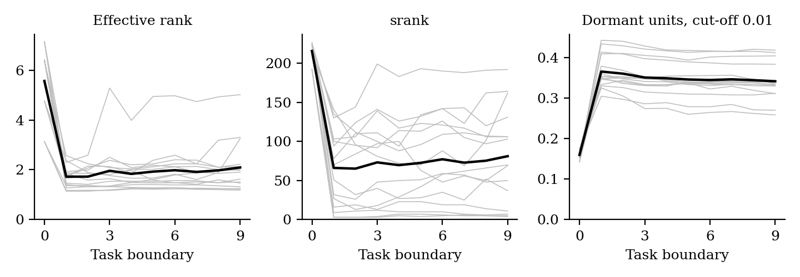

# Rank-based plasticity indicators and directly measured learning ability in a hypernetwork continual learner

## Abstract

A network trained on tasks in sequence can lose the ability to learn new ones.
Measuring that loss directly means training the network on a further task,
which is costly enough that it is rarely repeated, so practitioners read it off
the weights instead, using effective rank, srank, or the fraction of dormant
units. Each is normalised so that overall scale cannot change it, which is
taken to mean that two readings may be compared.

We test the three against the quantity they stand for, on fifteen streams of
nine 20-class Tiny ImageNet tasks in a hypernetwork continual learner, with the
direct measurement repeated 990 times so that every model carries its own noise
floor. Curvature is read on the same models as a fourth measure, to separate
what belongs to this family of measure from what belongs to the reading.

The reading protocol decides the result. Every indicator value of this kind is
read through one set of BatchNorm statistics, and which set is almost never
reported. Read through the fixed statistics of a freshly built network the
indicators fall on every run; read through statistics measured from the same
weights they rise, and at the end of the stream the two readings differ by a
factor of 51. An ordinary ResNet50 reproduces the fall more strongly, while
learning every group it is given. Curvature, which reads no features and
divides by no norm, splits at the same two points and by a wider margin, so
what the protocol selects is where a model is read and not which measure is
used.

The rest of the paper stays with the fixed protocol, because it is the reading
a hypernetwork gets by default. Under it every indicator reports a loss while
measured fit to an unseen task improves on all fifteen runs. The largest
correlation between the two is 0.212 and carries the wrong sign. A model with
one task destroyed to chance moves both rank measures in the direction they
report as healthy. Whether these three results survive matched statistics is
not tested here, so they are consequences of the protocol and not independent
of it. What they establish is narrower and still worth having: in this setting
the reading a practitioner takes by default is not evidence about the ability
to learn.

# 1 Introduction

A model that has learned many tasks may fit the next one worse than a freshly
started model would. The direct way to find out is to train it on that next
task and look, which costs one training run per reading. That is why the
measurement is usually run once, reported without an error bar, and rarely
repeated.

Three measures are used instead, all read with no training: effective rank (Roy
and Vetterli, 2007), srank (Kumar et al., 2021), and the fraction of dormant
units (Sokar et al., 2023). All three divide away the overall size of what they
measure, and that normalisation is what licenses a comparison between two
models.

This paper puts the three and the direct measurement side by side on the same
models, in a setting where the direct measurement is cheap enough to repeat
eleven times at every reading point. We report four results: a reading choice
that nobody reports decides the sign of the indicator result, for a curvature
measure as well as for the three; the reported fall
reproduces more strongly on an ordinary ResNet50 that learns every group it is
given; read through that protocol the indicators and the direct measurement
disagree in direction and the size of the indicator change does not rank the
runs; and repeating the direct
measurement gives each model a noise floor, which turns a reported change into
a claim that can be checked.

# 2 Method

**Model and stream.** A generator writes the weights of a ResNet50 from a
32-number task code; the target network is never trained directly. The stream
is 200 Tiny ImageNet classes in 10 disjoint groups of 20. Groups 0 to 8 are
learned in sequence and group 9 is held out entirely, so chance accuracy on the
held-out group is 5 percent. Each group is trained for 5 epochs at batch size
64, at a learning rate chosen by a sweep run beforehand. Fifteen streams were
run: three orderings, five seeds each. A reading is taken at every boundary,
numbered 0 before any task and 9 after the ninth.

**Reading protocol.** The weights are generated from one fixed reference code,
never trained, so that a change between boundaries is a change in the generator
and not in the code. The BatchNorm layers are given the statistics a freshly
built ResNet50 carries, a running mean of zero and a running variance of one at
every layer, never updated, because the generator writes weights but no running
statistics. The model is read in evaluation mode at the 2048 features entering
the final classifier, on 256 fixed images. Section 3.1 reads the same models a
second way, through statistics measured from their own weights over 2048
training images from the nine learned groups.

**Measures.** Effective rank and srank with delta = 0.01 are computed from the
singular values of the 256 by 2048 feature matrix. The dormant-unit fraction,
at cut-offs 0.01, 0.025 and 0.1, is not read there. It is scored at every ReLU
call in the network, on the same 256 images, each unit against the mean of its
own call site. Sites differ in scale by orders of magnitude, so one
network-wide mean would mark every quiet layer dormant and every loud one
healthy.

**The direct probe.** A copy of the model is taken, a fresh task code is drawn
for the held-out group, the generator and that code are trained together for
250 steps, the accuracy is recorded, and the copy is discarded, so the
measurement cannot change the model it measures. The probe runs eleven times at
each point, and each repetition is run at three learning rates with the best
kept on a validation split. Fifteen streams at two points, eleven repetitions
each, three rates apiece, is 990 probe runs in all. Each run's noise floor is
1.96 s sqrt(1/11 + 1/11), where s is the standard deviation of its eleven
boundary-0 repetitions.

**The damaged model and the control.** After the ninth group each stream
destroys one group it has already learned; that group reads 5.00 percent
afterwards in all fifteen streams, which is exactly chance. Separately, an
ordinary ResNet50 with one classifier head per group was trained on the same
nine groups in the same order with the same settings, three seeds. It shares no
component with the hypernetwork, so behaviour common to both belongs to the
reading and not to the architecture.

# 3 Results

## 3.1 The reading protocol decides the direction

Table 1 reads the same checkpoints twice: through the fixed statistics of the
protocol, and through statistics measured from the models' own weights.

Table 1. Each measure at the start and the end of the stream, read twice from
the same models. The hypernetwork rows are the mean over five seeds of ordering
A, the control rows the mean over three seeds.

| Measure | Network | Fixed, b0 | Fixed, b9 | Matched, b0 | Matched, b9 |
| --- | --- | --- | --- | --- | --- |
| Effective rank | Hypernetwork | 5.56 | 2.79 | 106.27 | 143.00 |
| Effective rank | Ordinary ResNet50 | 7.30 | 1.14 | 7.30 | 110.51 |
| srank | Hypernetwork | 215.6 | 120.4 | 248.2 | 248.4 |
| srank | Ordinary ResNet50 | 226.0 | 2.7 | 226.0 | 245.3 |
| Dormant units, cut-off 0.01 | Hypernetwork | 0.160 | 0.324 | 0.000 | 0.128 |
| Dormant units, cut-off 0.01 | Ordinary ResNet50 | 0.156 | 0.527 | 0.156 | 0.000 |

The route decides the direction of travel, not only its size. Through the fixed
statistics the hypernetwork's effective rank falls from 5.56 to 2.79 over the
nine groups; through matched statistics the same five checkpoints rise from
106.27 to 143.00, a factor of 51 apart at boundary 9. The control behaves the
same way, falling from 7.30 to 1.14 and rising to 110.51, and its fixed reading
at boundary 9 is lower than any value the hypernetwork reaches although it
learns every group at the moment that group is given to it. The dormant-unit
fraction tells the same story: on the fixed route the control rises further than
the hypernetwork, and on the matched route the two move in opposite directions.

Appendix B locates the failure. A BatchNorm layer performs two operations and
the protocol supplies a wrong value for each; correcting either alone recovers
0.2 and 4.3 percent of the gap at boundary 9, so a partial fix such as centring
the features does not repair the reading.

## 3.2 The same split appears on a measure that reads no features

The result above could be read narrowly, as a fact about three measures that
all read the same features through the same normalisation. This section tests
it on a measure that does none of those things.

Curvature treats the training loss as a landscape and asks how sharply the
ground bends where the model stands. A flat valley is easy to move around in; a
narrow steep one is not, and the literature reads a rise in curvature as a loss
of plasticity. It is measured here by stepping the generator a small distance in
a random direction, reading the loss, stepping the same distance the other way,
and reading it again. Averaging the two and subtracting the loss in the middle
cancels the slope and leaves the bend, which averaged over random directions is
the mean eigenvalue of the Hessian. It reads no features, divides by no norm,
and shares no machinery with effective rank, srank or the dormant count.

Where to stand is the same choice as before. Table 2 reads the same five models
from the protocol's fixed code on fixed statistics, and from a code the stream
trained on that group's own statistics.

Table 2. Mean Hessian eigenvalue on five seeds of ordering A, read from two
points, 40 random directions at each of three step sizes. Each entry is the
range across the five seeds. The trained code is first in the ordering, and
boundary 4 is the earliest boundary kept in storage at which its code exists.
The middle column repeats the fixed arm over boundary 4 to boundary 9, which is
the span the trained arm covers, so the first and last columns can be read
without a difference in span between them. The last two rows divide each
reading by the loss at the same point.

| Quantity | Fixed code, fixed statistics | Fixed code, same span as the trained arm | Trained code, own statistics |
| --- | --- | --- | --- |
| Boundaries read | 0 and 9 | 4 and 9 | 4 and 9 |
| Curvature at the earlier boundary | 0.0088 to 248.7 | 543.2 to 1.19e10 | -5.12e-7 to 2.67e-5 |
| Curvature at boundary 9 | 5.73e5 to 1.13e12 | 5.73e5 to 1.13e12 | -2.20e-5 to 5.52e-5 |
| Ratio, boundary 9 over the earlier one | 6.53e7 to 5.95e12 | 33.7 to 1.06e3 | . |
| Seeds that rise past their own floor | 5 of 5 | 5 of 5 | 2 of 5 |
| Step sizes on which all five seeds agree | 3 of 3 | 3 of 3 | 0 of 3 |
| Loss at boundary 9, where chance is 3.00 | 1.39e9 to 3.52e15 | 1.39e9 to 3.52e15 | 2.20 to 2.49 |
| Curvature over that loss, earlier boundary | 2.44e-4 to 3.75e-4 | 1.34e-4 to 3.14e-4 | -2.0e-7 to 1.18e-5 |
| Curvature over that loss, boundary 9 | 3.20e-4 to 4.78e-4 | 3.20e-4 to 4.78e-4 | -9.28e-6 to 2.35e-5 |

Read from the protocol's own point, curvature reports a sharpening of between
seven and thirteen factors of ten, past each seed's own floor on 5 of 5 seeds,
and all three step sizes agree. Read from a code the stream trained, there is no
rise to report: 2 of 5 seeds rise past their floor, two of the others fall past
it, and the three step sizes agree on 0 of 3. The two readings of the same five
models differ by at least ten factors of ten.

The span of stream covered is not what separates them. Over boundary 4 to
boundary 9, which is the trained arm's own span, the fixed arm still rises past
its floor on 5 of 5 seeds and all three step sizes still agree, while the
trained arm over that same span rises on 2. The sharpening it reports is
smaller over the shorter span, 34 to about a thousand rather than seven to
thirteen factors of ten, which is what a shorter span should do. The direction
does not change. Three things still differ between the outer columns: the task
code, the BatchNorm statistics and the group of pictures. Section 3.1 and
Appendix B show that the statistics alone account for a gap of this kind on the
rank measures, and no arm here separates the three.

The loss says why. At the protocol's point it reaches 3.52e15 at boundary 9,
where chance for a group of twenty classes is 3.00, so the network there is not
merely performing badly but producing values far outside the range in which a
loss means anything. At the trained code the same models read between 2.20 and
2.49, below chance, which is what a model that knows the group should do.
Dividing each curvature reading by the loss at the same point leaves a quantity
that stays inside a single factor of two across both boundaries and all five
seeds, while the readings it is built from span fourteen factors of ten. The
sharpening is the loss scale.

Two things follow. The reading point decides the direction here as it does in
Table 1, on a measure that has nothing in common with the three this paper
tests, so the finding is about where a model is read and not about rank. And
the correction is not a normalisation: dividing out the loss removes the rise
but leaves the two reading points one to two factors of ten apart, so the
choice of point cannot be repaired after the fact.

Appendix I gives the reading for each seed.

## 3.3 The indicators fall while measured learning rises

Read through the protocol, the stream produces the fall these measures were
built to detect. Over the same stream the direct measurement moves the other
way.

Every indicator reading in this section and in the two that follow is taken
through the fixed protocol of Section 3.1. That protocol is the one a
hypernetwork gets unless someone intervenes, because the generator writes
weights and no running statistics, so these sections report what a reader of
these measures would actually see. They do not report what the measures would
say under matched statistics, which is not measured on these fifteen streams.
The probe is not affected either way: it trains a copy and counts the result,
and no choice of BatchNorm statistics enters it.

Table 3. Each indicator and the direct probe, averaged over the fifteen runs.
The last column counts the runs that move in the stated direction.

| Quantity | Boundary 0 | Boundary 9 | Runs |
| --- | --- | --- | --- |
| Effective rank | 5.56 | 2.09 | fell in 15 of 15 |
| srank | 215.6 | 81.1 | fell in 15 of 15 |
| Dormant units, cut-off 0.01 | 0.160 | 0.342 | rose in 15 of 15 |
| Probe accuracy | 26.20% | 44.08% | rose in 15 of 15 |

Boundary 0 is the comparison the literature uses: the generator is still at its
random starting values, so the two endpoints ask whether a model that has
learned nine tasks fits a new one better or worse than a freshly started model
given the same budget. A loss of plasticity is the case where it does worse.
Every run does better, by 17.87 points on average against a chance level of 5
percent. The smallest gain is 15.90 points and the largest noise floor is 2.72,
so no run comes close to its own floor. Two controls on the ordering A streams
say what the gain is not. A probe on twenty CIFAR-100 classes, sharing no class
and no source with the stream, gains +20.61 points against those streams'
+17.00, so the gain is not transfer confined to one dataset. The same probe
with the generator frozen, leaving only the 32-number code to train, reads
between 4.14 and 5.84 percent at both ends against a chance level of 5, so the
ability being measured sits in the generator weights. Appendix C gives both in
full.

## 3.4 The size of the fall does not rank the runs

Both quantities vary widely across the fifteen runs, the indicator readings
again through the fixed protocol. The effective-rank fall runs from 29.8 to
80.6 percent and the probe gain from 15.90 to 20.49 points. If the fall
reports the ability to learn, the runs that fell furthest should be the runs
that gained least.

Table 4. Correlation between each indicator's change and the probe's change.
Column r counts all fifteen runs. The three orderings of one seed share a
starting network, so the five-seed columns average those three first and
correlate the five averages. The end-value columns repeat both tests on the
boundary-9 values rather than on the changes.

| Measure | Predicted sign | r | r, five seeds | r, end values | r, end values, five seeds |
| --- | --- | --- | --- | --- | --- |
| Effective rank | positive | -0.054 | +0.327 | -0.165 | -0.350 |
| srank | positive | -0.178 | +0.209 | -0.212 | -0.049 |
| Dormant units, cut-off 0.01 | negative | +0.129 | +0.077 | +0.164 | +0.187 |
| Dormant units, cut-off 0.025 | negative | +0.125 | +0.076 | +0.162 | +0.175 |
| Dormant units, cut-off 0.1 | negative | +0.112 | +0.095 | +0.139 | +0.178 |

Figure 1. Change in effective rank against change in probe accuracy, one point
per run. Error bars are each run's own standard error on the probe change. The
dashed line is the least-squares fit.

Each measure predicts a sign. Counted over the fifteen runs all five come out
with the wrong one. Counted over the five seeds the two rank measures turn over
and read +0.327 and +0.209, which is the sign they predict, while the three
dormant cut-offs stay the wrong way up. The failure on sign therefore depends
on which count is used and the paper does not rest on it. The end-value columns
set the differences aside and ask whether, among the finished models, the one
with the higher reading fits the unseen task better. It does not, at either
count, for effective rank.

What does not depend on the count is size. The eleven repetitions show the
outcome is not at fault: of the spread in the gain across the fifteen runs,
46.2 percent by variance is real difference between models rather than
measurement noise, which caps any predictor at a correlation of 0.680. The
largest value in Table 4 is 0.350. At fifteen runs a correlation needs 0.514 to
be separable from zero at the 5 percent level and at five seeds it needs 0.878.
Nothing in the table reaches either. The five numbers are also closer to two:
the three dormant cut-offs correlate between 0.993 and 0.999 with one another,
and effective rank correlates 0.690 with srank.

## 3.5 The indicators call a damaged model healthy

If the indicators report anything about the health of a model, a model with one
group destroyed to chance should read worse than the same model one step
earlier. Both readings here are taken through the fixed protocol, as in the two
sections above. Boundary 10 was not read under matched statistics.

Table 5. The unlearning step and the weight-scale controls, averaged over the
fifteen streams. The ordinary learning step is the average absolute change from
one boundary to the next over the 120 steps after the first.

| Quantity | Effective rank | srank |
| --- | --- | --- |
| Change at the unlearning step | +1.580 | +73.6 |
| One ordinary learning step | 0.162 | 10.025 |
| Change with the weight norm held at its boundary 9 value | +0.754 | +37.7 |
| Change produced by shrinking the undamaged model alone | +1.314 | +53.9 |

Both rank measures rise at the unlearning step, in every stream, and a rise is
the direction they report as healthy. The movement is large beside ordinary
learning: effective rank moves 1.580 against 0.162 for a typical learning step,
9.8 times as far and in the opposite direction.

Part of that movement is the size of the weights, which the unlearning step
leaves at 0.757 of its earlier value. Both rank measures are normalised so that
multiplying the feature matrix by a constant cannot change them, but that does
not cover the weights, which sit upstream: a residual block adds its input to a
branch of weighted layers, so scaling every weight changes the branch and
leaves the input path alone. Holding the norm fixed removes about half of the
movement and imposing it alone reproduces most of it; the two bounds disagree,
so no single share is available. What survives the first control is +0.754 on
effective rank, 4.7 times an ordinary learning step, in 14 of the 15 streams,
so the weight scale does not explain the result away.

# 4 Discussion

Read the way a hypernetwork delivers them, the three measures respond to
something, and on this evidence it is not the ability to learn. Two of the
things they do respond to are identified here: the
reading protocol, which decides the sign of the result and is not usually
reported, and the size of the generated weights, which reaches the reading
along a path the measures' own normalisation does not cover.

The protocol result travels furthest, because it does not depend on the
architecture or on the family of measure: curvature, which reads no features
at all, splits at the same two points and by a wider margin. Nor does it
depend on the hypernetwork: the control contains no hypernetwork and
reproduces the published fall more strongly while learning every group it is
given. An indicator value is therefore incomplete without the protocol that
produced it, and a change in one is not evidence about learning until the
direct measurement has been run at least once on the same models. None of this
shows the measures are meaningless everywhere: this is one architecture, one
dataset and one kind of learning.

# 5 Limitations

Sections 3.3 to 3.5 read the indicators through the fixed protocol alone.
Matched statistics were measured on five models at two boundaries, which is
Section 3.1, and not on the fifteen streams at every boundary or at boundary
10. So those three sections say what the default reading does and not what the
measures would do if the protocol were corrected first. The checkpoints that
would answer it are kept, and the run needs forward passes only.

One model family, one hypernetwork, one dataset. The probe trains the
generator, so part of the measured gain is ordinary transfer. A probe on
twenty CIFAR-100 classes keeps 121 percent of the gain (Table C3), which rules
out transfer confined to the stream's own dataset and does not rule out general
visual features, because boundary 0 is a randomly started network and general
features would predict a gain of this size on any natural-image task. Both that
control and the frozen-generator control of Table C4 are ordering A and five of
the fifteen runs. The indicators move almost entirely at the first task, so the
endpoint comparison is largely untrained against trained, and the probe was not
read at boundary 1. The fifteen runs share five starting points. The three
orderings of one seed begin from the same model and differ by up to about two
points on the boundary-0 probe reading for reasons not established here, and
because they are not independent the correlations of Table 4 are reported at
both counts, where the sign of the change test turns over. No test for srank
was stated before the measurements were taken. Appendix B is on ordering A alone, and the
control has three seeds against the hypernetwork's five. The curvature reading
is the mean eigenvalue of the Hessian and not the largest, which is what most of
the sharpness literature reports; it covers one group, the first in ordering A,
and its trained-code arm begins at boundary 4 because boundary 1 was not kept.

# References

Kumar, A., Agarwal, R., Ghosh, D., and Levine, S. Implicit under-parameterization
inhibits data-efficient deep reinforcement learning. In International Conference
on Learning Representations (ICLR), 2021. arXiv:2010.14498.

Roy, O. and Vetterli, M. The effective rank: a measure of effective
dimensionality. In Proceedings of the 15th European Signal Processing Conference
(EUSIPCO), pages 606-610, Poznan, Poland, 2007.

Sokar, G., Agarwal, R., Castro, P. S., and Evci, U. The dormant neuron
phenomenon in deep reinforcement learning. In Proceedings of the 40th
International Conference on Machine Learning (ICML), PMLR 202:32145-32168, 2023.
arXiv:2302.12902.

These are the three works cited in the body. The wider plasticity references
carried in version 1 return when the Introduction cites them.

# Appendix A Indicator trajectories over the stream

Fifteen streams were run: three orderings of the nine task groups, five seeds
each. All five measures were read at every task boundary on the same 256
in-stream images. Every run moves the way a loss of plasticity would predict.
Effective rank and srank fall in all fifteen, and the dormant-unit fraction
rises in all fifteen at each of the three cut-offs.

Nearly all of that movement happens at the first task (Table A1, Figure A1).
Averaged over the fifteen runs, effective rank falls from 5.56 to 1.72 after
one task of the nine and ends at 2.09. srank falls from 215.6 to 66.1 and ends
at 81.1. The dormant fraction at cut-off 0.01 rises from 0.160 to 0.366 and
ends at 0.342. Each measure passes its boundary-9 value after a single task
and then moves back a little, and the last column of Table A1 counts how many
runs move back that way.

Table A1. Each measure averaged over the fifteen runs, at the start of the
stream, after the first task, and after the ninth. The last column counts the
runs whose boundary-9 reading has moved back toward the starting value
compared with boundary 1.

| Measure | Boundary 0 | Boundary 1 | Boundary 9 | Runs moving back |
| --- | --- | --- | --- | --- |
| Effective rank | 5.56 | 1.72 | 2.09 | 10 of 15 |
| srank | 215.6 | 66.1 | 81.1 | 10 of 15 |
| Dormant units, cut-off 0.01 | 0.160 | 0.366 | 0.342 | 15 of 15 |
| Dormant units, cut-off 0.025 | 0.197 | 0.401 | 0.381 | 15 of 15 |
| Dormant units, cut-off 0.1 | 0.290 | 0.480 | 0.469 | 13 of 15 |

The direction is the same everywhere, but the size of the change is not. The
five seeds of one ordering differ from each other about as much as the three
orderings differ from each other (Table A2). For effective rank the mean change
is 3.6 times the spread between runs; for srank it is 2.2 times. A measure
whose mean is only twice its spread cannot separate two models from one run
each, which is the point Appendix A returns to.

Table A2. Change from boundary 0 to boundary 9, as a percent of the boundary 0
value. Each ordering column gives the mean over its five seeds, with the
standard deviation between those seeds in brackets. The last column is the
mean over all fifteen runs divided by their standard deviation.

| Measure | Ordering A | Ordering B | Ordering C | All fifteen | Mean / spread |
| --- | --- | --- | --- | --- | --- |
| Effective rank | -50.3 (18.1) | -63.6 (20.0) | -69.7 (6.0) | -61.2 (17.0) | 3.6 |
| srank | -45.5 (30.9) | -67.9 (31.4) | -76.2 (16.4) | -63.2 (28.5) | 2.2 |
| Dormant units, cut-off 0.01 | +104.8 (44.8) | +121.7 (50.4) | +122.2 (31.2) | +116.2 (40.6) | 2.9 |
| Dormant units, cut-off 0.025 | +86.8 (35.3) | +99.2 (39.6) | +100.1 (25.4) | +95.4 (32.0) | 3.0 |
| Dormant units, cut-off 0.1 | +58.7 (20.0) | +64.2 (21.6) | +64.5 (14.3) | +62.5 (17.7) | 3.5 |

Figure A1. Each measure against the task boundary, on the in_stream images. One
thin grey line per run, with the mean over the fifteen runs in black. The three
cut-offs behave alike, so only 0.01 is drawn.

A seed fixes the starting generator, and the ordering decides only which task
group comes first, so the three orderings of one seed begin from the same
model. The boundary-0 readings confirm this: they agree across the three
orderings to within floating-point noise. The indicator reading at boundary 0
therefore repeats exactly, which matters for Appendix C, where the probe's
reading of the same point does not.

Under this reading protocol the stream does produce the fall these measures
were built to detect. The next section reads the same models through
statistics measured from their own weights and finds the opposite direction,
so the protocol is part of what Table A1 reports. Whether the size of the fall
tracks how well the model can still learn is the question Appendix D puts to it.
The per-run values are in the stored records.

A single-run comparison between orderings is not supported by this spread.
Version 1 of this work reported an ordering effect from one run per ordering.
Table A2 shows that the five seeds of one ordering differ from each other about
as much as the three orderings differ from each other, so that comparison is
withdrawn.

# Appendix B The reading protocol in full

Every reading in the main body is taken through one fixed set of BatchNorm
statistics. The hypernetwork generates the target network's weights
but writes no BatchNorm running statistics, so the trainer keeps the statistics
that a freshly built ResNet50 has, a running mean of zero and a running
variance of one at every layer, and passes those to every forward pass. They
are never updated. This section asks what the indicators read when the
statistics are measured from the model's own weights instead.

Two models are read. The first is the five ordering A streams of Appendix A,
read at boundary 0 and boundary 9 from the saved checkpoints, with the weights
generated from the same fixed reference code used throughout. The second is a
control: an ordinary ResNet50 with one classifier head per group, trained on the
same nine groups in the same order with the same settings, three seeds. The
control shares no component with the hypernetwork, so any behaviour common to
both belongs to the reading and not to the architecture. Nothing is trained for
the hypernetwork half; both routes are forward passes over the same 256
in-stream images. The matched statistics are measured on 2048 training images
from the nine learned groups, with the BatchNorm layers in training mode and a
cumulative average, so the result does not depend on the order of the batches.

Table B1. Each measure at the start and the end of the stream, read twice from
the same models. The fixed columns use the protocol used throughout. The
matched columns use statistics measured from the model's own weights. The
hypernetwork rows are the mean over five seeds of ordering A, the control rows
the mean over three seeds.

| Measure | Network | Fixed, b0 | Fixed, b9 | Matched, b0 | Matched, b9 |
| --- | --- | --- | --- | --- | --- |
| Effective rank | Hypernetwork | 5.56 | 2.79 | 106.27 | 143.00 |
| Effective rank | Ordinary ResNet50 | 7.30 | 1.14 | 7.30 | 110.51 |
| srank | Hypernetwork | 215.6 | 120.4 | 248.2 | 248.4 |
| srank | Ordinary ResNet50 | 226.0 | 2.7 | 226.0 | 245.3 |
| Mean row share | Hypernetwork | 0.981 | 0.983 | 0.805 | 0.865 |
| Mean row share | Ordinary ResNet50 | 0.982 | 0.960 | 0.982 | 0.709 |
| Dormant units, cut-off 0.01 | Hypernetwork | 0.160 | 0.324 | 0.000 | 0.128 |
| Dormant units, cut-off 0.01 | Ordinary ResNet50 | 0.156 | 0.527 | 0.156 | 0.000 |

The reading route decides the direction of travel, not only its size. Read
through the fixed statistics the hypernetwork's effective rank falls from 5.56
to 2.79 over the nine groups, which is the result Appendix A reports. Read
through matched statistics the same five checkpoints rise from 106.27 to 143.00.
The control behaves the same way, falling from 7.30 to 1.14 on the fixed route
and rising from 7.30 to 110.51 on the matched one. The two routes agree at
boundary 0 for the control, because a network that has not trained yet has not
moved its statistics, and they separate from the first group onward.

The control is learning throughout the stream that produces its fall. Its fixed
reading of 1.14 at boundary 9 is lower than any value the hypernetwork reaches,
and it is taken from a network that reaches the accuracy in Table B6 on each
group at the moment that group is learned. An indicator that reports a severe
loss on a network with no loss to report is not measuring the quantity it is
read for.

srank behaves the same way and reaches a floor. On the fixed route the control
falls from 226.0 to 2.7, so it uses three of the 256 available directions. On
the matched route it ends at 245.3. The hypernetwork's matched readings sit at
248.2 and 248.4, which is close enough to the 256 ceiling that this measure
cannot separate a model that is flat from one that is saturated, and no claim is
made from the matched srank column.

The dormant-unit fraction gives the same verdict on the fixed route and a
different result on the matched one. On the fixed route the control rises from
0.156 to 0.527, a larger rise than the hypernetwork's 0.160 to 0.324, so the
reported rise is reproduced more strongly by the network that has no problem.
On the matched route the two architectures move in opposite directions. The
control starts at 0.156 and reads 0.000 from the first group onward in all three
seeds and at all nine boundaries. The hypernetwork starts at 0.000 in all five
seeds and ends at 0.128, with per-seed values between 0.109 and 0.181. Ordinary
sequential training removes every dormant unit in this setting, and generating
the weights from a task code creates them. The control's floor at zero means
this comparison establishes a difference in direction and not a difference in
size.

The mean row share is the one measure whose matched readings separate the two
architectures by level as well. Both networks read about 0.98 on the fixed
route at both boundaries, which is the shared-direction result of Appendix D.
On the matched route the hypernetwork rises from 0.805 to 0.865 while the
control falls from 0.982 to 0.709.

Table B2 locates where the fall on the fixed route happens. The 256 by 2048
feature matrix is read at the classifier's input, which in a ResNet50 is the
output of the last ReLU, so every value in it is non-negative. If the fixed
statistics shift the whole signal upward, the ReLU removes little, every image
gives a similar row, and effective rank falls for that reason alone. The same
matrix was therefore read one step earlier, at the input of the last ReLU, where
negative values are still present.

Table B2. Effective rank and mean row share on the fixed route, read at the input
of the last ReLU and at its output, with the share of values the ReLU sets to
zero. Same models and same images as Table B1.

| Measure | Network | Before, b0 | Before, b9 | After, b0 | After, b9 |
| --- | --- | --- | --- | --- | --- |
| Effective rank | Hypernetwork | 6.17 | 2.47 | 5.56 | 2.79 |
| Effective rank | Ordinary ResNet50 | 8.34 | 1.10 | 7.30 | 1.14 |
| Mean row share | Hypernetwork | 0.981 | 0.984 | 0.981 | 0.983 |
| Mean row share | Ordinary ResNet50 | 0.982 | 0.960 | 0.982 | 0.960 |
| Share the ReLU sets to zero | Hypernetwork | 0.331 | 0.492 | . | . |
| Share the ReLU sets to zero | Ordinary ResNet50 | 0.338 | 0.751 | . | . |

The fall is already complete before the ReLU runs. The hypernetwork reads 2.47
before the ReLU against 2.79 after it, and the control reads 1.10 against 1.14.
The mean row share is unchanged by the ReLU to three decimals on both networks
at both boundaries. The ReLU is nevertheless doing work, removing between 0.331
and 0.751 of all values, so this is not a case of a nonlinearity with nothing to
remove. So the last ReLU is not what collapses the rank. That is as far as this reading
reaches. The signal it measures has already passed every earlier ReLU in the
network, so the result clears the final clipping and says nothing about
nonlinearity in general. Where the fall happens, and which half of the
BatchNorm operation is responsible, are the two questions the rest of this
section answers.

The error the protocol makes grows with depth. Each BatchNorm layer is told to
divide by a spread of one. The measured spread at boundary 9 runs from 0.838 to
5.752 across the 53 layers, so most layers pass their signal on several times
larger than they should, and the next layer repeats the mistake. Table B3 reads
the average size of the values at the output of each of the 16 blocks, under the
fixed route and under matched statistics, at the end of the stream.

Table B3. The average size of the values at each block output, on the five
ordering A models at boundary 9, before any averaging over the picture. The
fixed column is the study's protocol and the measured column uses statistics
taken from the model's own weights.

| Block | Channels | Fixed | Measured |
| --- | --- | --- | --- |
| layer1.0 | 256 | 11.87 | 1.203 |
| layer1.1 | 256 | 179 | 1.445 |
| layer1.2 | 256 | 1169 | 1.593 |
| layer2.0 | 512 | 1.816e+04 | 1.292 |
| layer2.1 | 512 | 2.692e+05 | 1.600 |
| layer2.2 | 512 | 1.579e+06 | 1.593 |
| layer2.3 | 512 | 8.098e+06 | 1.452 |
| layer3.0 | 1024 | 1.254e+08 | 1.075 |
| layer3.1 | 1024 | 1.063e+09 | 1.382 |
| layer3.2 | 1024 | 4.058e+09 | 1.654 |
| layer3.3 | 1024 | 3.149e+10 | 1.755 |
| layer3.4 | 1024 | 1.097e+11 | 1.937 |
| layer3.5 | 1024 | 7.898e+11 | 2.120 |
| layer4.0 | 2048 | 4.305e+12 | 0.4835 |
| layer4.1 | 2048 | 2.468e+13 | 0.5234 |
| layer4.2 | 2048 | 1.090e+14 | 0.4676 |

The fixed route grows by roughly a factor of ten at each block and ends about
thirteen orders of magnitude above where it started. The measured route stays
near one across all sixteen. At boundary 0 the same fixed column ends at
2.968e4 rather than 1.090e14, so the error is small on an untrained generator
and grows as the weights travel. That is the direct explanation for why the
reading gets worse over the stream.

The rank does not follow the same shape. On the fixed route at boundary 9
effective rank reads 5.135 at the first block, 2.337 at the second, and 2.789 at
the sixteenth. Mean row share reads 0.983 at the first block and 0.983 at the
sixteenth. Almost all of the collapse is present after one block, and fifteen
further blocks of a growing scale do not lower it. So the growth in Table B3
explains the size of the values and not the rank, and the two have to be
reported separately.

A BatchNorm layer performs two operations, subtracting a running mean and
dividing by the square root of a running variance, and the protocol supplies a
wrong value for each. Table B4 separates them. The same five models are read
four ways: with the protocol's values for both, with the measured mean and the
protocol's variance, with the protocol's mean and the measured variance, and
with both measured. The last column gives each arm's recovery as a share of the
distance between the protocol reading and the fully measured one at boundary 9.

Table B4. Effective rank at the classifier under each set of BatchNorm
statistics, averaged over the five ordering A models, on the in_stream images.

| Statistics supplied | Boundary 0 | Boundary 9 | Share of the gap at boundary 9 |
| --- | --- | --- | --- |
| Mean 0, variance 1 (the protocol) | 5.563 | 2.789 | . |
| Measured mean, variance 1 | 63.615 | 3.093 | 0.2 |
| Mean 0, measured variance | 32.960 | 8.860 | 4.3 |
| Both measured | 106.274 | 143.001 | 100.0 |

Neither operation accounts for the result on its own. At boundary 9 the gap
between the protocol reading and the measured one is 140.212. Correcting only
the subtraction recovers 0.2 percent of it and correcting only the division
recovers 4.3 percent, while correcting both recovers all of it. The failure is
therefore not attributable to either operation separately.

The two operations are close to separable at the start of the stream and are not
separable at the end. At boundary 0 the same two corrections recover 57.6 and
27.2 percent of a gap of 100.711, which sums to 84.8 percent; at boundary 9 they
sum to 4.5 percent. The measured statistics give the same account from the other
side, with spreads running 0.362 to 2.358 at boundary 0 and 0.838 to 5.752 at
boundary 9.

Each single correction also introduces a second fault. Correcting the division
alone brings the average size of the values at the last block down from 1.090e14
to 1.969, close to the measured arm's 0.4676, but raises mean row share to
0.993, the highest of the four arms, because the offset that is never subtracted
is then the largest remaining structure in the signal. Correcting the
subtraction alone lowers mean row share to 0.964 and raises the average size to
1.674e14. Neither arm is a partial repair of the protocol.

The practical consequence is the one a reader is most likely to need. A
correction to one half of the protocol, such as centring the features before
measuring, does not restore the reading at the end of a stream.

One limit is stated rather than tested. On the fixed route the values reach the
order of 1e14 in a single-precision forward pass. That is far inside the range
of the format, and the rank arithmetic itself is carried out in double
precision, so no overflow occurs. How much relative precision remains at that
magnitude has not been measured. The measured arm, on which every comparison in
this section rests, stays near one throughout.

One further choice is specific to a hypernetwork and is settled by the same
result. The generator does not hold one set of weights. It writes a set from
whatever 32-number task code it is handed, so a different code gives a
different ResNet50 from the same generator. An instruction to read the rank of
such a model is incomplete until the code is named. Every reading in this paper
uses one fixed reference code, drawn from seed 20261030 and never trained, so
that a change between boundaries is a change in the generator and not in the
code.

Table B5 asks what that choice costs. The same models are read a second time
through the nine codes each stream actually trained, averaged over the nine.

Table B5. Effective rank at the classifier at boundary 9, read through the fixed
reference code and through the codes each stream trained. The five-stream rows
are ordering A and are the same models and images as Tables B1 to B4. The
fifteen-stream rows are all three orderings, and the matched route was not run
on them. The last column is the sum over the 53 BatchNorm layers of the base-10
logarithm of the measured spread, which is zero if the protocol's assumption
holds at every layer.

| Streams | Code | Fixed statistics | Matched statistics | Total log spread |
| --- | --- | --- | --- | --- |
| Five, ordering A | reference | 2.789 | 143.001 | 20.42 |
| Five, ordering A | trained, averaged | 3.837 | 137.542 | 13.17 |
| Fifteen, all orderings | reference | 2.095 | . | . |
| Fifteen, all orderings | trained, averaged | 2.792 | . | . |

Under the fixed statistics the code matters. A trained code reads 3.837 against
the reference code's 2.789, a ratio of 1.38, on the same model and the same
images. The fifteen-stream rows give the same ratio, 2.792 against 2.095. The
two subsets differ because ordering A falls least of the three (Table A2), and
the fifteen-stream reference value is the one Table A1 reports.

Under matched statistics the code stops mattering. The same comparison reads
137.542 against 143.001, a ratio of 0.96. When each generated network is read
through statistics that match it, which code produced the weights barely
changes the answer.

The reason is that a trained code sits closer to what the protocol assumes. The
last column of Table B5 adds up, across the 53 BatchNorm layers, how far each
layer's measured spread is from the assumed value of one, on a logarithmic
scale so that layers above and below one do not cancel. The reference code
reaches 20.42 and the trained codes 13.17. Per layer the average distance is
0.393 against 0.268. The protocol is wrong about both, and it is less wrong
about a code the generator has trained, which is why that code is penalised
less. This quantity is a measure of the mismatch and not the growth itself: the
spreads are measured along the matched path, so their sum does not predict the
size of the values in Table B3.

The code sensitivity is therefore not a second trap. It is the fixed-statistics
result seen from another angle, and a reader who corrects the statistics has
corrected it too. What survives is the reporting rule: a rank level published
for a hypernetwork is a property of the model and the code together, so the
code has to be stated for the number to be comparable with anyone else's.

Table B6 is not filled. The control network's per-group accuracy was computed
during the run and printed, and the saved log holds only the indicator
readings, so the numbers cannot be recovered from storage. The run takes about
five minutes a seed and is set to five seeds, which matches the hypernetwork's
five on this ordering. Until it is repeated, the claim
that the control learned every group it was given rests on the run's printed
output and not on a published record.

Table B6. Accuracy of the control network. Pending a repeat of the run.

# Appendix C The direct probe

The probe asks the model the question the indicators only guess at: give it a
task it has never seen, let it train on that task with a fixed budget, and see
how well it does. A copy of the whole model is taken first and put back
afterwards, so the measurement cannot change the model it measures. Inside
that copy both the generator and a fresh 32-number code for the new task
train; neither is frozen. The probe was run on the held-out group of twenty
classes at the start of each stream and again at the end, eleven times at each
point.

This makes the boundary-0 reading the comparison the plasticity literature
uses. At boundary 0 the generator is still at its random starting values, so
the question the two endpoints put is whether a model that has learned nine
tasks fits a new one better or worse than a freshly started model given the
same budget. A loss of plasticity is the case where it does worse.

Every run ends better than it started (Table C1, Figure C1). Accuracy goes from
26.20% before any task to 44.08% after nine, a gain of 17.87 points against a
chance level of 5%. The smallest gain in the fifteen runs is 15.90 points and
the largest is 20.49. The spread between runs is small next to the gain
itself.

Table C1. Probe accuracy on the held-out group, averaged over the fifteen runs
and over the eleven repetitions at each point. Inside each repetition the
learning rate is the one with the best validation accuracy in that repetition,
so every run contributes its best of three rates. Appendix G counts the same
runs without selecting and reports a lower figure for the same point.

| Point in the stream | Probe accuracy | Gain over chance |
| --- | --- | --- |
| Boundary 0, before any task | 26.20% | 21.20 points |
| Boundary 9, after nine tasks | 44.08% | 39.08 points |

The gain is far larger than the measurement can produce on its own. Each run
carries its own floor, built from the spread of its eleven repetitions at
boundary 0 and read as the smallest change that would survive that spread at
the 5% level. The largest floor in the fifteen runs is 2.72 points, and the
smallest gain is 15.90 (Table C2). No run comes close to its floor, so the rise
is not a reading error.

Table C2. The gain for each run against its own noise floor. The floor is
1.96 s sqrt(1/11 + 1/11), where s is the standard deviation of the eleven
boundary-0 repetitions for that run.

| Run | Boundary 0 | Boundary 9 | Gain | Floor | Gain clears floor |
| --- | --- | --- | --- | --- | --- |
| A0 | 26.13% | 43.72% | +17.59 | 1.70 | yes |
| A1 | 27.25% | 43.65% | +16.40 | 2.72 | yes |
| A2 | 26.06% | 43.75% | +17.68 | 2.10 | yes |
| A3 | 26.55% | 42.76% | +16.22 | 1.26 | yes |
| A4 | 26.78% | 43.90% | +17.12 | 2.07 | yes |
| B0 | 25.50% | 42.39% | +16.89 | 1.62 | yes |
| B1 | 26.35% | 43.81% | +17.45 | 1.91 | yes |
| B2 | 26.15% | 44.24% | +18.09 | 1.81 | yes |
| B3 | 26.21% | 44.03% | +17.82 | 2.63 | yes |
| B4 | 26.05% | 45.28% | +19.24 | 1.60 | yes |
| C0 | 27.41% | 43.31% | +15.90 | 1.67 | yes |
| C1 | 25.27% | 44.45% | +19.18 | 1.82 | yes |
| C2 | 24.95% | 45.44% | +20.49 | 1.48 | yes |
| C3 | 26.39% | 45.36% | +18.97 | 2.31 | yes |
| C4 | 26.01% | 45.04% | +19.03 | 2.27 | yes |

Figure C1. Probe accuracy for each run. The open circle is boundary 0 and the
filled circle is boundary 9. The dotted line is chance for a twenty-class
group.

One caveat belongs here. The three orderings of a seed start from the same
model, so their three boundary-0 readings should agree, and they do not: for
seed 0 they are 26.13%, 25.50% and 27.41%. The largest such gap is about two
points, which is roughly the size of a noise floor and well under the gain, so
it does not touch the result of this section. Table C2 holds every boundary-0
reading, and the cause of the spread is not established here.

Two controls bound what the gain can mean, and both were measured on these
same checkpoints.

The first changes the dataset. If the gain were transfer between neighbouring
classes of one dataset, a probe task from another source should show less of
it. The same probe was run on twenty CIFAR-100 classes, on the five ordering A
checkpoints, with every other setting held: 250 steps, eleven repetitions,
three rates chosen per repetition, 4,800 training images, chance at 5 percent.

Table C3. The direct probe on twenty CIFAR-100 classes, ordering A, five seeds.
The floor is built the same way as in Table C2.

| Run | Boundary 0 | Boundary 9 | Gain | Floor | Gain clears floor |
| --- | --- | --- | --- | --- | --- |
| A0 | 34.45% | 55.03% | +20.59 | 2.21 | yes |
| A1 | 33.20% | 55.89% | +22.69 | 1.33 | yes |
| A2 | 33.09% | 53.93% | +20.84 | 1.86 | yes |
| A3 | 33.31% | 52.15% | +18.85 | 1.85 | yes |
| A4 | 33.55% | 53.61% | +20.07 | 1.55 | yes |
| mean | 33.52% | 54.12% | +20.61 | . | 5 of 5 |

The gain is +20.61 points where the same five streams gain +17.00 on the Tiny
ImageNet probe. A task that shares no class, no picture and no source with the
stream keeps 121 percent of the gain rather than losing it, and every run
clears its own floor. CIFAR-100 is simply the easier twenty-class task at this
budget, higher at both ends, and what matters is that the distance between the
ends survives the change of source. Read at boundary 4 as well, it has the same
shape as the Tiny ImageNet probe: +20.17 points by task 4 and +0.44 after,
which is 0.6 standard errors from zero on four degrees of freedom.

This rules out the narrow explanation and not the broad one. Transfer between
neighbouring classes of a single dataset does not survive a probe on another
dataset. General visual features do: they help on any natural-image task, and
boundary 0 is a randomly started network, so a gain of this size on an
unrelated dataset is also what general features predict. The paper claims the
narrow case is ruled out and claims no more than that.

The second control removes the generator from the probe. In the full arm the
generator and the fresh task code train together. In the frozen arm the
generator is held and only the 32-number code trains, which asks whether the
code alone can reach a held-out group.

Table C4. The probe with the generator frozen beside the full arm. Ordering A,
five seeds, same budget and same grid. Chance is 5 percent.

| Run | Full, b0 | Full, b9 | Frozen, b0 | Frozen, b9 |
| --- | --- | --- | --- | --- |
| A0 | 26.13% | 43.72% | 5.04% | 4.72% |
| A1 | 27.25% | 43.65% | 5.26% | 5.84% |
| A2 | 26.06% | 43.75% | 4.52% | 4.14% |
| A3 | 26.55% | 42.76% | 4.58% | 5.06% |
| A4 | 26.78% | 43.90% | 5.02% | 5.18% |

Every frozen reading sits between 4.14 and 5.84 percent. The frozen arm moves
by +0.10 points over the stream where the full arm moves by +17.00, so it is at
chance at both ends and has no change to report. Two things follow. The probe
has to be read as the full arm, because the frozen arm measures nothing. And a
32-number code cannot on its own steer this generator to a group of twenty
unseen classes, so whatever lets the model fit a new task sits in the generator
weights and not in the code space.

Both controls are ordering A and five of the fifteen runs. Neither was measured
on orderings B and C.

This is the result the indicators have to be judged against. Over the nine
tasks every indicator said the model was losing the ability to learn, and the
direct measurement says it fits a new task better, in all fifteen runs, by
more than ten times the largest floor. The probe trains the generator, so part
of that gain is ordinary transfer; Table C3 shows it is not transfer confined
to one dataset, and Section 5 of the main body lists what remains. Transfer
does not explain the disagreement, though: the indicators are read as a
statement about the model itself, and the model they call least able is the one
that learns best. Appendix D takes the weaker question: set the direction
aside, and ask only whether the runs that fell furthest are the runs that
gained least.

# Appendix D Correlations in full

Each of the fifteen runs gives a pair of numbers: how far an indicator moved
over the nine tasks, and how far probe accuracy moved over the same span. Both
vary widely. The effective-rank fall runs from 29.8% to 80.6%, a factor of
2.7, and the probe gain from 15.90 to 20.49 points (Table D1). If the fall
reports the ability to learn, the runs that fell furthest should be the runs
that gained least.

Table D1. Change from boundary 0 to boundary 9 on the in_stream images, across
the fifteen runs. Indicator changes are a percent of the boundary 0 value; the
probe change is in accuracy points.

| Quantity | Mean | Lowest | Highest |
| --- | --- | --- | --- |
| Effective rank | -61.20% | -80.58% | -29.81% |
| srank | -63.19% | -97.92% | -15.04% |
| Dormant units, cut-off 0.01 | +116.22% | +50.90% | +174.51% |
| Dormant units, cut-off 0.025 | +95.37% | +44.88% | +142.61% |
| Dormant units, cut-off 0.1 | +62.45% | +34.67% | +86.63% |
| Probe accuracy | +17.87 | +15.90 | +20.49 |

They are not. The correlation between the effective-rank fall and the probe
gain is -0.054, which accounts for 0.3% of the spread in the gain (Table D2,
Figure 1). srank gives -0.178 and the three dormant-unit cut-offs give +0.112
to +0.129.

Each measure also predicts a sign. A run whose rank fell less should have more
ability left, so the rank measures predict a positive correlation; dormant
units are read the other way and predict a negative one. Over the fifteen runs
all five come out with the wrong sign, and the largest of them accounts for
3.2% of the spread.

The fifteen runs are not fifteen independent draws. Orderings A, B and C at one
seed are three streams written by the same starting network, so one seed gives
three correlated points and not three separate ones. There are five starting
points. Averaging the three orderings of each seed and correlating the five
averages is the stricter count, and Table D2 reports both.

Table D2. Correlation between each indicator's change and the probe's change.
Column r counts all fifteen runs; the five-seed columns average the three
orderings of each seed first. The end-value columns repeat both tests on the
boundary-9 values themselves rather than on the changes.

| Measure | Predicted sign | r | r squared | r, five seeds | r, end values | r, end values, five seeds |
| --- | --- | --- | --- | --- | --- | --- |
| Effective rank | positive | -0.054 | 0.3% | +0.327 | -0.165 | -0.350 |
| srank | positive | -0.178 | 3.2% | +0.209 | -0.212 | -0.049 |
| Dormant units, cut-off 0.01 | negative | +0.129 | 1.7% | +0.077 | +0.164 | +0.187 |
| Dormant units, cut-off 0.025 | negative | +0.125 | 1.6% | +0.076 | +0.162 | +0.175 |
| Dormant units, cut-off 0.1 | negative | +0.112 | 1.3% | +0.095 | +0.139 | +0.178 |

The sign of the change test depends on which count is used. At five seeds the
two rank measures turn over to +0.327 and +0.209, the sign they predict, while
the three dormant cut-offs stay the wrong way up. The claim that all five fail
on sign therefore holds at fifteen runs and not at five seeds, and the paper
rests on the weaker statement instead: at no count is any of them large enough
to use. The end-value test does not turn over for effective rank at either
count.

The five numbers are also not five independent tests. Across the fifteen runs
the three dormant cut-offs correlate between 0.993 and 0.999 with one another,
and effective rank correlates 0.690 with srank, so the table is nearer to two
measurements reported five ways. `scripts/upgrade_suite/seed_clustered_correlations.py`
computes every value above from the published logs and checks the fifteen-run
column against the figures printed here.

Both quantities in that test are differences, and a difference inherits the
noise of both of its endpoints. The end-value columns of Table D2 therefore set
the differences aside and asks the plainer question: among the fifteen finished
models, does the one with the higher indicator reading fit the unseen task
better? It does not. Effective rank gives -0.165 and srank -0.212 where a
positive value was predicted, and the three dormant-unit cut-offs give +0.139
to +0.164 where a negative value was predicted. The sign is wrong in the same
way, so the result is not an artifact of dividing by a starting value.

A failed correlation means little if the gain it fails to predict is mostly
measurement noise, and the eleven repetitions at each point let the two be
separated. The gain's spread across the fifteen runs is 1.300 points. The
repetitions account for 0.953 of that, leaving 0.883 as real difference
between models, which is 46.2% of the spread by variance. An outcome measured
that well caps any predictor at a correlation of 0.680, the square root of
that share. That ceiling covers the change test only; the end-value test does
not take a difference and so is not subject to it. It does not need to be: the
largest value anywhere in Table D2 is 0.350, which sits in the five-seed column
where a correlation needs 0.878 to be separable from zero at the 5% level,
while the largest at fifteen runs is 0.212 against a threshold of 0.514.

Neither the size of an indicator's change nor its final value therefore says
anything usable about how well the model fits an unseen task, and the little
relation there is runs the wrong way. Appendix C asked the indicators to get
a direction right. This section asks less of them: set the direction aside and
only rank fifteen runs against each other. They fail that too. Appendix A
gives the per-run values.

# Appendix E The unlearning step

Appendices A to D ask whether the indicators track ordinary change. This
section asks an easier question. After the ninth group, each stream performs an
unlearning step that destroys one group it has already learned. The destroyed
group reads 5.00 percent afterwards in all fifteen streams, which is exactly
chance for a twenty-class task, so the damage is complete rather than partial.
If the indicators report anything about the health of a model, a model with one
group destroyed should read worse than the same model one step earlier.

The comparison is between boundary 9 and boundary 10 of the same stream. These
differ by the unlearning step alone. Both readings are taken on the same
in-stream images through the same protocol, so nothing but the model changes.

Table E1 also gives the size of an ordinary learning step, for scale. That number
is the average absolute change in the indicator from one boundary to the next
over the stream, excluding the first step, because Appendix A shows the first
step is not an ordinary one. Without it there is no way to judge whether the
movement at the unlearn is large or small.

Table E1. The unlearning step, averaged over the fifteen streams, on the
in-stream images. The last column counts streams in which the indicator moved in
the direction the measure reports as healthy. The final row of each block is the
average absolute change across one ordinary learning step, over the 120 steps
after the first.

| Quantity | Boundary 9 | Boundary 10 | Change | Healthy direction |
| --- | --- | --- | --- | --- |
| Accuracy of the destroyed group, percent | . | 5.00 | . | . |
| Effective rank | 2.095 | 3.675 | +1.580 | 15 of 15 |
| Effective rank, one ordinary learning step | . | . | 0.162 | . |
| srank | 81.1 | 154.7 | +73.6 | 15 of 15 |
| srank, one ordinary learning step | . | . | 10.025 | . |

Both rank measures rise at the unlearning step, in every stream. A rise is the
direction these measures report as healthy. So on a model whose accuracy on one
group has just been reduced to chance, both indicators read better than they did
before the damage.

The movement is also large beside ordinary learning. Effective rank moves 1.580
at the unlearn against 0.162 for a typical learning step, which is 9.8 times as
far and in the opposite direction. srank moves 73.6 against 10.025, which is 7.3
times as far. A measure that barely responds to eight groups of learning and then
moves roughly ten times further, in the healthy direction, when a group is
destroyed is not reporting the health of the model.

The accuracy of the destroyed group before the unlearning step is not recorded in
the rescaling-control file, which is why that cell is empty. It is not needed for
the comparison: a reading of exactly chance establishes that the group is gone.

Appendix F asks what the indicators are responding to instead.

# Appendix F The contribution of weight scale

Both rank measures divide the singular values of the feature matrix by their
sum, so multiplying the whole feature matrix by a constant cannot change either
of them. That property is usually read as meaning the measures are free of
scale. It does not follow, because the property holds of the feature matrix and
the weights sit upstream of it.

A residual block adds its input to a branch of several weighted layers.
Multiply every generated weight by a constant and the branch changes by a power
of that constant, set by how many weight layers it contains, while the input
path carries no weights and does not change at all. Their sum is therefore not
the original sum multiplied by any single number. The generated bias terms and
the generated BatchNorm scale and offset break the same symmetry a second time.
So a change in the size of the weights does not reach the features as one
multiplying constant, and a normalisation that only removes such a constant
cannot remove it.

The ReLU is not the reason. For any positive constant c, the ReLU of c times a
value equals c times the ReLU of that value, so a positive rescale passes
through it unchanged.

The unlearning step changes the size of the generated weights. Averaged over the
fifteen streams, the weight norm after the unlearn is 0.757 of its value before.
That is a large change in one step, and it is in the shrinking direction. So the
rise reported in Appendix E has a second possible explanation that has nothing
to do with the representation.

Two interventions separate the two explanations, and they are not equivalent.
The first takes the damaged model and scales its generated weights back up to the
norm they had before the unlearn, which asks how much of the rise survives when
the size is held fixed. The second takes the undamaged model and shrinks its
weights by the same factor the unlearn produced, changing nothing else, which
asks how much of the rise the size alone can produce.

Table F1. The two interventions, averaged over the fifteen streams, on the
in-stream images. The share is the ratio of the averages, not the average of the
per-run ratios, because several runs have a change near zero and dividing by it
gives per-run shares ranging from below minus one to above one.

| Quantity | Effective rank | srank |
| --- | --- | --- |
| Change at the unlearn | +1.580 | +73.6 |
| Change with the weight norm held at its boundary 9 value | +0.754 | +37.7 |
| Change produced by shrinking the undamaged model alone | +1.314 | +53.9 |
| Share carried by the weight norm, first intervention | 52.3 percent | 48.8 percent |
| Share carried by the weight norm, second intervention | 83.2 percent | 73.3 percent |

The weight norm carries a large part of the movement on both measures, and the
two interventions do not agree on how large. On effective rank they give 52.3
percent and 83.2 percent, a gap of about a third of the whole change. On srank
they give 48.8 percent and 73.3 percent. The two paths would agree if the size
and the direction contributed independently. They do not, so there is no single
number for the share and both have to be reported.

What survives the first intervention is still in the unhealthy direction for the
argument of Appendix E. Holding the norm fixed leaves +0.754 on effective rank,
which is 4.7 times the size of an ordinary learning step from Table E1, in 14 of
the 15 streams. So the weight scale does not explain the result away. The reading
still improves after the damage.

Two limits. The interventions change the weight norm by rescaling, which is a
single global factor and not the kind of change training produces, so they bound
the contribution rather than measure it as training would. And the second
intervention moves in the same direction in 11 of 15 streams against 14 of 15 for
the first, so it is the less consistent of the two.

# Appendix G Learning speed on the held-out group

Appendix C reports one number per probe run: the accuracy reached after a fixed
budget of 250 steps. That number mixes two quantities that the loss-of-plasticity
literature keeps apart. The first is speed, meaning how quickly the model fits
the new task. The second is the ceiling, meaning how well it can do once it has
finished. A model that has lost plasticity is expected to be slower, and the
usual evidence for that is a learning curve rather than a single endpoint.

No new run was needed. The probe already recorded four readings on every curve,
at steps 62, 125, 188 and 250, each with the training loss and the test accuracy.
Runs are compared in matched pairs. A boundary 0 run and a boundary 9 run that
share an ordering, a seed, a learning rate and a repetition number started from
the same fresh task code and saw the same batches in the same order, so they
differ only in the model being probed. Pairing removes the spread that comes from
the starting code, which is the largest source of noise in this measurement.

Table G1. Test accuracy on the held-out group at each of the four readings,
averaged over the runs at that boundary, with the paired gap against boundary 0
beneath. Boundaries 0 and 9 use all fifteen streams; boundary 4 is ordering A
only. A star marks a gap larger than its own 95 percent interval.

| Boundary | Step 62 | Step 125 | Step 188 | Step 250 | Runs |
| --- | --- | --- | --- | --- | --- |
| t = 0 | 9.78 | 15.07 | 18.47 | 21.27 | 495 |
| t = 4 | 30.58 | 36.33 | 36.44 | 38.84 | 165 |
| t = 9 | 32.85 | 36.96 | 38.25 | 39.57 | 495 |
| gap, t = 4 minus t = 0 | +20.78* | +21.15* | +17.69* | +17.63* | 165 |
| gap, t = 9 minus t = 0 | +23.07* | +21.89* | +19.78* | +18.29* | 495 |

Table G1 reads lower at step 250 than Table C1 reads at the same point: 21.27
against 26.20 at boundary 0, and 39.57 against 44.08 at boundary 9. The two
tables count the same 990 runs by different rules. Table C1 keeps one learning
rate per repetition, the one that did best on that repetition's validation
split. Table G1 averages all three. A curve has to be built from runs that are
comparable at every step, and choosing a rate by its result at step 250 would
join three different curves into one. So the selected figure answers how well
the model can fit the task, the averaged figure answers what shape the fitting
takes, and neither corrects the other.

The gap between the end of the stream and the start is widest at the first
reading and narrows from there. It is +23.07 points at step 62 and +18.29 points
at step 250. That is the shape of a difference in speed. A difference in ceiling
alone would show the opposite shape, with the two curves close early and
separating as they approach their limits.

The first reading also lies outside the range the untrained generator reaches at
all. At step 62 the end-of-stream model is at 32.85 percent, which is higher than
the 21.27 percent the untrained generator reaches after the whole budget of 250
steps. One quarter of the budget at boundary 9 beats the full budget at boundary
0.

The training loss agrees. At boundary 0 it moves from 3.00 to 2.31 over the
budget. At boundary 9 it moves from 1.91 to 0.70. The model late in the stream
starts lower and falls further, so the effect is present in fitting the probe
task and not only in generalising from it.

Table G2 separates speed from the ceiling directly. For each run, its accuracy at
step 62 is divided by its own accuracy at step 250. The result says how much of
that run's own final result was already reached early. Dividing each run by its
own ceiling is what makes this a measure of speed: a model that ends higher while
moving at the same pace gives the same share.

Table G2. Share of a run's own step-250 accuracy already reached at step 62,
averaged over the runs at that boundary, with the paired gap against boundary 0
and its 95 percent interval.

| Boundary | Share at step 62 | Paired gap against t = 0 | 95 percent interval | Runs |
| --- | --- | --- | --- | --- |
| t = 0 | 0.476 | . | . | 495 |
| t = 4 | 0.787 | +0.299 | 0.052 | 165 |
| t = 9 | 0.837 | +0.361 | 0.028 | 495 |

The share rises from 0.476 to 0.837 over the stream, and the paired gain of
+0.361 is more than twelve times its own interval. The model late in the stream
is faster at the held-out group, not only better at it. This is the opposite of
the behaviour a loss of plasticity predicts, measured on the quantity that
literature asks about.

One comparison in this section disagrees with Appendix D and both numbers are
reported. Appendix D finds the accuracy endpoint complete at boundary 4, with no
detectable change from boundary 4 to boundary 9. The speed share does change over
that interval. On ordering A, where boundary 4 was measured, the share rises by
+0.076 from boundary 4 to boundary 9. Counting every repetition as an observation
gives a 95 percent interval of 0.044, and counting each seed once, which is the
conservative treatment because the eleven repetitions of one seed probe the same
two models, gives 0.063. The gain is larger than both intervals, but it is larger
than the conservative one by a small margin, and it rests on five seeds of a
single ordering. It is reported as evidence that the speed gain continues past the
point where the accuracy endpoint stops, and not as a settled result.

**Script.** `scripts/learning_speed.py`.

# Appendix H Work not yet carried out on the present design

| Measurement | Notebook | Cost to repeat |
| --- | --- | --- |
| Probe at five points along the stream | `40_probe_curve.ipynb` | forks and discards |
| Random-label fitting | `41_matched_random_labels.ipynb` | forks and discards |
| Learning speed of an unseen task | `40_probe_curve.ipynb` data | no new run needed |
| Learning after deliberate damage | 7 November record | one stream |
| Random-direction control | `39_random_direction_control.ipynb` | trains nothing |
| Effective-rank convergence across seeds | stored records | no new run needed |
| Probe at the middle of the stream | `47_probe_on_the_revised_streams.ipynb` | 495 probe runs |

# Appendix I Curvature

Curvature is measured without training anything. The generator is stepped a
distance along a random direction drawn evenly over all of its parameters, the
loss is read, the generator is restored, it is stepped the same distance the
other way, and the loss is read again. Half the sum of the two readings, minus
the loss in the middle, is the bend alone, because the two slope terms are equal
and opposite and cancel. Dividing by the squared step gives the curvature along
that direction, and the average over random directions is the mean eigenvalue of
the Hessian.

Three step sizes are used, 0.001, 0.003 and 0.01 of the generator's own length,
with 40 directions at each. A central difference only measures curvature while
the step is small enough that the surface still looks like a parabola, so three
sizes that disagree about the direction of a change mean the reading is not
converged. The same directions are drawn at both reading points, so nothing
differs between the two arms except where they stand.

The two arms are the same choice Appendix B makes for the rank measures. The
fixed arm stands at the protocol's reference code, which belongs to no group and
was never trained, on the fixed statistics of a freshly built network, reading
held-out pictures of the group no stream learns. The trained arm stands at the
code for group 0, which is first in ordering A, on the statistics the trainer
kept for that group while learning it, reading held-out pictures of that group.
Giving the trained arm the fixed statistics instead sends its loss to the eighth
power of ten, because it runs a trained network on statistics it was never
calibrated for; the measurement refuses to continue when that happens.

Table I1. Curvature at the fixed code on fixed statistics, with the loss at the
same point. Chance for a group of twenty classes is a loss of 3.00.

| Seed | Curvature, b0 | Curvature, b9 | Ratio | Loss, b0 | Loss, b9 |
| --- | --- | --- | --- | --- | --- |
| 0 | 0.025 | 2.784e10 | 1.11e12 | 74.86 | 5.819e13 |
| 1 | 0.06752 | 4.02e11 | 5.95e12 | 276.4 | 9.392e14 |
| 2 | 0.6707 | 3.628e10 | 5.41e10 | 1878 | 8.140e13 |
| 3 | 248.7 | 1.126e12 | 4.53e9 | 6.632e5 | 3.520e15 |
| 4 | 0.008776 | 5.730e5 | 6.53e7 | 26.72 | 1.390e9 |

Every seed rises past its own floor, and the floors are far below the changes:
the smallest change is 5.73e5 against a floor of 7.361e4. The three step sizes
agree, with all five seeds rising at each of them.

Table I2. Curvature at group 0's trained code on that group's own statistics.
The floor is the usual 95 percent interval for a difference of two means, built
from the spread across the 120 directions at each point.

| Seed | Curvature, b4 | Curvature, b9 | Change | Floor | Verdict |
| --- | --- | --- | --- | --- | --- |
| 0 | 3.483e-6 | -2.202e-5 | -2.550e-5 | 6.299e-6 | fell |
| 1 | 2.331e-5 | 2.701e-5 | 3.704e-6 | 1.207e-5 | flat |
| 2 | -5.117e-7 | 2.421e-5 | 2.473e-5 | 7.546e-6 | rose |
| 3 | 1.518e-5 | 9.395e-6 | -5.783e-6 | 2.603e-6 | fell |
| 4 | 2.673e-5 | 5.516e-5 | 2.844e-5 | 1.212e-5 | rose |

Four of the five clear their floor, but two rise and two fall, and the three
step sizes do not agree: counting seeds that rise, they give 2, 3 and 3 out of
five. This arm therefore reports movement without a direction, which is weaker
than the flat reading an earlier design produced, and it is not a rise. The
loss at these points runs from 1.827 to 2.600 at boundary 4 and from 2.200 to
2.485 at boundary 9.

Seed 2 reads a small negative value at boundary 4. A negative mean eigenvalue
means that point is not a local minimum once averaged over directions. It is
reported and not investigated.

Table I1 and Table I2 cover different spans of the stream, so the comparison
between them carries that difference as well as the difference in reading
point. The fixed arm was measured at boundary 4 too, 600 readings that the
published log already holds, so the span can be matched and removed. Table I4
is the fixed arm over the trained arm's own span.

Table I4. Curvature at the fixed code on fixed statistics, read over boundary 4
to boundary 9. Same models, same directions and same floor rule as Table I1.

| Seed | Curvature, b4 | Curvature, b9 | Change | Floor | Verdict |
| --- | --- | --- | --- | --- | --- |
| 0 | 2.077e8 | 2.784e10 | 2.763e10 | 2.502e9 | rose |
| 1 | 1.192e10 | 4.020e11 | 3.900e11 | 3.756e10 | rose |
| 2 | 2.044e8 | 3.628e10 | 3.607e10 | 3.879e9 | rose |
| 3 | 1.896e9 | 1.126e12 | 1.124e12 | 1.412e11 | rose |
| 4 | 543.2 | 5.730e5 | 5.724e5 | 7.361e4 | rose |

All five seeds rise past their own floor over this span, and all three step
sizes agree, which is what Table I1 reports over the longer one. The ratio
falls from between 6.53e7 and 5.95e12 to between 33.7 and 1.06e3, so most of
the size of the published rise belongs to the first four tasks. Its direction
does not depend on the span. Table I2 over the same span rises on 2 of 5 seeds
and falls on 2, so the two arms still disagree once the span is held fixed.

Table I3. Each curvature reading divided by the loss at the same point.

| Seed | Fixed, b0 | Fixed, b9 | Ratio | Trained, b4 | Trained, b9 |
| --- | --- | --- | --- | --- | --- |
| 0 | 3.34e-4 | 4.78e-4 | 1.43 | 1.91e-6 | -9.28e-6 |
| 1 | 2.44e-4 | 4.28e-4 | 1.75 | 1.18e-5 | 1.09e-5 |
| 2 | 3.57e-4 | 4.46e-4 | 1.25 | -1.97e-7 | 1.04e-5 |
| 3 | 3.75e-4 | 3.20e-4 | 0.85 | 7.71e-6 | 4.27e-6 |
| 4 | 3.28e-4 | 4.12e-4 | 1.26 | 1.15e-5 | 2.35e-5 |

The ten fixed-arm entries of Table I1 span fourteen factors of ten. Divided by
the loss at the same point they lie between 2.44e-4 and 4.78e-4, a spread of
less than two, and the ratio across the stream runs from 0.85 to 1.75. The rise
in Table I1 is the loss scale and almost nothing else. The division does not
make the two arms agree: the trained arm stays one to two factors of ten lower
after it.

This result was first obtained on a retired eight-task design with three seeds,
where the fixed arm rose by 13.7, 6.5 and 5.5 times and the trained arm did not
move at all. Those numbers are not used here, because they come from a design
this paper's method section does not describe. The present run is five seeds of
ordering A, 3,000 measurements, with no training.

**Notebook.** `notebooks/53_curvature_on_the_revised_streams.ipynb`.
