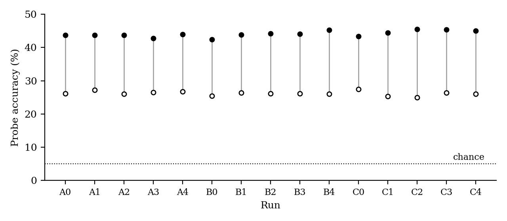
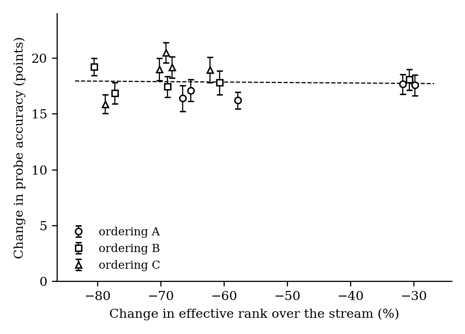

# Rank-based plasticity indicators and directly measured learning ability in a hypernetwork continual learner

Skeleton, 15 November 2026. Title, abstract and section plan only. Each
section below states what it will contain, which experiment supplies it, and
which notebook produced the data. No results are written yet.

Two alternative titles are recorded in the paper plan.

## Abstract

A network that learns tasks in sequence can become worse at learning the next
one. Detecting that loss matters, but measuring it directly means training the
network on a further task, which is costly enough that it is rarely repeated.
Practitioners therefore rely on measures read from the weights or activations
alone, with no training. Three are in wide use: effective rank, srank, and the
fraction of dormant units. Each is normalized so that overall scale cannot
affect it, which is taken to mean that two readings may be compared directly.

How closely these measures follow the quantity they stand for is largely
untested, because the direct measurement is usually run once and so carries no
error bar of its own. We run it 990 times. Each run is short and works on a
copy that is restored afterwards, so the same point can be measured again and
again and each model gets its own noise floor.

We run fifteen streams of nine 20-class Tiny ImageNet tasks, as three task
orderings with five random seeds each, holding a tenth group of classes out of
training. At the start and the end of every stream we train the model on that
held-out group for a fixed short budget, eleven times at each point, and
record how well it fits.

Across the fifteen runs the size of the indicator change does not account for
the differences in measured learning, and its sign is the opposite of the one
the usual reading predicts. The same holds when the end values are used in
place of the changes. The indicators fall in every run while the model's
measured fit to an unseen task improves in every run. A model with one task deliberately
reduced to chance accuracy moves the indicators in the direction they report
as healthy, and holding the weight scale fixed removes about half of that
movement. We also retract an earlier single-run result on task ordering, which
the five-seed measurement does not support.

In this setting, a reading of these measures is not evidence about the ability
to learn. The weight-scale result shows where the failure comes from: both
rank measures reach the generated weights along a path that their own scale
normalization does not cover, so a comparison between models of different
weight scale is in part a comparison of those scales.

---

# 1 Introduction

**Contents.** The problem of diagnosing lost plasticity without training.
The implicit promise of a scale-normalized measure. Why a hypernetwork is a
useful test setting: the generator can be frozen and a task code trained in
its place, which gives a direct measurement at a cost low enough to repeat.
Statement of contributions.

**Contributions to list.** One per result that is measured on the present
design. Draft wording to be settled after Section 5 is written, so the claims
and their evidence are fixed first.

**Source.** No new data. Written from Sections 5 and 6.

**Status.** To write last.

---

# 2 Related work

**Contents.** Loss of plasticity in continual learning, and the correlates
usually named for it. The three measures and their original sources: effective
rank (Roy and Vetterli, 2007), srank (Kumar et al., 2021), dormant units
(Sokar et al., 2023). The unlearning method that supplies the damaged model
(UnCLe). What is new here, which is the controls rather than the measures or
the setting.

**Carry over.** Section 2 of the version 1 draft can be reused with small
changes. The measures and their sources have not changed.

**Source.** Literature only.

**Status.** Mostly carried over from version 1.

---

# 3 Method

## 3.1 Model and task stream

**Contents.** The hypernetwork and the ResNet50 it generates, with parameter
counts. The 32-number task code. The class split: 200 Tiny ImageNet classes in
10 disjoint groups of 20, nine learned and group 9 held out. Chance accuracy
of 5 percent. Why the eight-task, ten-class split used in version 1 was
replaced.

**Source.** Configuration in `uncle/config.py`. Design recorded in the
trajectory page for 12 November 2026.

**Status.** To write. Replaces Section 3.1 of version 1, which describes the
retired design.

## 3.2 Training and the learning-rate sweep

**Contents.** Optimizer, step counts, batch size, and how the learning rate
was chosen. Why a sweep was needed before the streams were run.

**Experiment.** Learning-rate sweep.

**Notebook.** `43_learning_rate_sweep.ipynb`.

**Status.** To write. Belongs in Method, not in Results.

## 3.3 Reading protocol

**Contents.** The four choices that make a reading describe the generator
rather than whichever task is loaded: one reference code (seed 20261030),
fixed BatchNorm statistics with the model in evaluation mode, one layer (the
2048 features at the input to the final classifier), and three fixed image
sets of 256 images each. What the three image sets are and why they differ in
distance from the training distribution.

**Carry over.** Section 3.2 of version 1 is correct as written and applies
unchanged to the present design.

**Status.** Carried over from version 1.

## 3.4 Measures

**Contents.** Definition of effective rank, srank with delta = 0.01, and the
dormant-unit fraction at cut-offs 0.01, 0.025 and 0.1. The normalization each
one applies, and what that normalization is taken to guarantee.

**Carry over.** Section 3.3 of version 1.

**Status.** Carried over from version 1.

## 3.5 The direct probe

**Contents.** The procedure: copy the model, draw a fresh 32-number code for
the held-out group, train the generator and that code together for a fixed
number of steps, record accuracy, and restore the model. What trains and what
does not, stated plainly, because the paper's claim depends on it. The
learning-rate choice within the probe, made on a validation split. The eleven
repetitions and the noise floor taken from their spread. The two control arms
that exist in the code and were not used here: `code_only`, which freezes the
generator, and `train_code=False`, which freezes the code.

**Experiment.** Experiment 2 in the explainer.

**Notebook.** `47_probe_on_the_revised_streams.ipynb`. Earlier version on the
retired design: `38_matched_probe.ipynb`.

**Status.** To write. New section; version 1 had no equivalent.

## 3.6 The unlearning step

**Contents.** What UnCLe does to the generated parameters of a forgotten task,
the 100-step burn-in, and how the resulting model is read. The rescaling
control: four readings per pair, so that the part of the indicator movement
caused by weight scale can be separated from the rest.

**Experiment.** Experiment 4 in the explainer.

**Notebook.** `46_rescaling_control.ipynb`.

**Status.** To write.

---

# 4 Experimental design

## 4.1 Orderings and seeds

**Contents.** The three orderings, with the table of partition indices. Which
six groups are fixed and which three rotate. Five seeds per ordering, fifteen
streams in total. Why five seeds, and what the 13 November spread reading
showed about the number of runs a single comparison needs.

**Experiments.** The stream runs.

**Notebooks.** `44_order_A_five_seeds.ipynb`, `45_orders_B_and_C.ipynb`.

**Table to include.** The three orderings by partition index. Carried over in
form from Table 1 of version 1, with new values.

**Status.** To write.

## 4.2 What each measurement contributes

**Contents.** A short table mapping each result section to the experiment and
notebook behind it, and to the design it was measured on. This is the section
that keeps the retired-design results visibly separate from the present ones.

**Status.** To write.

---

# 5 Results

## 5.1 The indicators move at the first task and then hold

Fifteen streams were run: three orderings of the nine task groups, five seeds
each. All five measures were read at every task boundary on the same 256
in-stream images. Every run moves the way a loss of plasticity would predict.
Effective rank and srank fall in all fifteen, and the dormant-unit fraction
rises in all fifteen at each of the three cut-offs.

Nearly all of that movement happens at the first task (Table 2, Figure 1).
Averaged over the fifteen runs, effective rank falls from 5.56 to 1.72 after
one task of the nine and ends at 2.09. srank falls from 215.6 to 66.1 and ends
at 81.1. The dormant fraction at cut-off 0.01 rises from 0.160 to 0.366 and
ends at 0.342. Each measure passes its boundary-9 value after a single task
and then moves back a little, and the last column of Table 2 counts how many
runs move back that way.

Table 2. Each measure averaged over the fifteen runs, at the start of the
stream, after the first task, and after the ninth. The last column counts the
runs whose boundary-9 reading has moved back toward the starting value
compared with boundary 1.

| Measure | Boundary 0 | Boundary 1 | Boundary 9 | Runs moving back |
| --- | --- | --- | --- | --- |
| Effective rank | 5.56 | 1.72 | 2.09 | 10 of 15 |
| srank | 215.6 | 66.1 | 81.1 | 10 of 15 |
| Dormant units, cut-off 0.01 | 0.160 | 0.366 | 0.342 | 15 of 15 |
| Dormant units, cut-off 0.025 | 0.197 | 0.401 | 0.381 | 15 of 15 |
| Dormant units, cut-off 0.1 | 0.290 | 0.480 | 0.469 | 13 of 15 |

The direction is the same everywhere, but the size of the change is not. The
five seeds of one ordering differ from each other about as much as the three
orderings differ from each other (Table 3). For effective rank the mean change
is 3.6 times the spread between runs; for srank it is 2.2 times. A measure
whose mean is only twice its spread cannot separate two models from one run
each, which is the point Section 5.6 returns to.

Table 3. Change from boundary 0 to boundary 9, as a percent of the boundary 0
value. Each ordering column gives the mean over its five seeds, with the
standard deviation between those seeds in brackets. The last column is the
mean over all fifteen runs divided by their standard deviation.

| Measure | Ordering A | Ordering B | Ordering C | All fifteen | Mean / spread |
| --- | --- | --- | --- | --- | --- |
| Effective rank | -50.3 (18.1) | -63.6 (20.0) | -69.7 (6.0) | -61.2 (17.0) | 3.6 |
| srank | -45.5 (30.9) | -67.9 (31.4) | -76.2 (16.4) | -63.2 (28.5) | 2.2 |
| Dormant units, cut-off 0.01 | +104.8 (44.8) | +121.7 (50.4) | +122.2 (31.2) | +116.2 (40.6) | 2.9 |
| Dormant units, cut-off 0.025 | +86.8 (35.3) | +99.2 (39.6) | +100.1 (25.4) | +95.4 (32.0) | 3.0 |
| Dormant units, cut-off 0.1 | +58.7 (20.0) | +64.2 (21.6) | +64.5 (14.3) | +62.5 (17.7) | 3.5 |

Figure 1. Each measure against the task boundary, on the in_stream images. One
thin grey line per run, with the mean over the fifteen runs in black. The three
cut-offs behave alike, so only 0.01 is drawn.

A seed fixes the starting generator, and the ordering decides only which task
group comes first, so the three orderings of one seed begin from the same
model. The boundary-0 readings confirm this: they agree across the three
orderings to within floating-point noise. The indicator reading at boundary 0
therefore repeats exactly, which matters for Section 5.7, where the probe's
reading of the same point does not.

The stream does produce the fall these measures were built to detect, then.
Whether the size of that fall tracks how well the model can still learn is the
question Section 5.3 puts to it. Appendix A gives the per-run values.

## 5.2 Measured learning ability rises over the same stream

The probe asks the model the question the indicators only guess at: give it a
task it has never seen, let it train on that task with a fixed budget, and see
how well it does. A copy of the whole model is taken first and put back
afterwards, so the measurement cannot change the model it measures. Inside
that copy both the generator and a fresh 32-number code for the new task
train; neither is frozen. The probe was run on the held-out group of twenty
classes at the start of each stream and again at the end, eleven times at each
point.

This makes the boundary-0 reading the comparison the plasticity literature
uses. At boundary 0 the generator is still at its random starting values, so
the question the two endpoints put is whether a model that has learned nine
tasks fits a new one better or worse than a freshly started model given the
same budget. A loss of plasticity is the case where it does worse.

Every run ends better than it started (Table 4, Figure 2). Accuracy goes from
26.20% before any task to 44.08% after nine, a gain of 17.87 points against a
chance level of 5%. The smallest gain in the fifteen runs is 15.90 points and
the largest is 20.49. The spread between runs is small next to the gain
itself.

Table 4. Probe accuracy on the held-out group, averaged over the fifteen runs
and over the eleven repetitions at each point.

| Point in the stream | Probe accuracy | Gain over chance |
| --- | --- | --- |
| Boundary 0, before any task | 26.20% | 21.20 points |
| Boundary 9, after nine tasks | 44.08% | 39.08 points |

The gain is far larger than the measurement can produce on its own. Each run
carries its own floor, built from the spread of its eleven repetitions at
boundary 0 and read as the smallest change that would survive that spread at
the 5% level. The largest floor in the fifteen runs is 2.72 points, and the
smallest gain is 15.90 (Table 5). No run comes close to its floor, so the rise
is not a reading error.

Table 5. The gain for each run against its own noise floor. The floor is
1.96 s sqrt(1/11 + 1/11), where s is the standard deviation of the eleven
boundary-0 repetitions for that run.

| Run | Boundary 0 | Boundary 9 | Gain | Floor | Gain clears floor |
| --- | --- | --- | --- | --- | --- |
| A0 | 26.13% | 43.72% | +17.59 | 1.70 | yes |
| A1 | 27.25% | 43.65% | +16.40 | 2.72 | yes |
| A2 | 26.06% | 43.75% | +17.68 | 2.10 | yes |
| A3 | 26.55% | 42.76% | +16.22 | 1.26 | yes |
| A4 | 26.78% | 43.90% | +17.12 | 2.07 | yes |
| B0 | 25.50% | 42.39% | +16.89 | 1.62 | yes |
| B1 | 26.35% | 43.81% | +17.45 | 1.91 | yes |
| B2 | 26.15% | 44.24% | +18.09 | 1.81 | yes |
| B3 | 26.21% | 44.03% | +17.82 | 2.63 | yes |
| B4 | 26.05% | 45.28% | +19.24 | 1.60 | yes |
| C0 | 27.41% | 43.31% | +15.90 | 1.67 | yes |
| C1 | 25.27% | 44.45% | +19.18 | 1.82 | yes |
| C2 | 24.95% | 45.44% | +20.49 | 1.48 | yes |
| C3 | 26.39% | 45.36% | +18.97 | 2.31 | yes |
| C4 | 26.01% | 45.04% | +19.03 | 2.27 | yes |

Figure 2. Probe accuracy for each run. The open circle is boundary 0 and the
filled circle is boundary 9. The dotted line is chance for a twenty-class
group.

One caveat belongs here. The three orderings of a seed start from the same
model, so their three boundary-0 readings should agree, and they do not: for
seed 0 they are 26.13%, 25.50% and 27.41%. The largest such gap is about two
points, which is roughly the size of a noise floor and well under the gain, so
it does not touch the result of this section. Section 5.7 reports the spread
in full and states what is known about its cause.

This is the result the indicators have to be judged against. Over the nine
tasks every indicator said the model was losing the ability to learn, and the
direct measurement says it fits a new task better, in all fifteen runs, by
more than ten times the largest floor. The probe trains the generator, so part
of that gain is ordinary transfer between tasks drawn from one dataset, and
Section 7 lists this among the limits. Transfer does not explain the
disagreement, though: the indicators are read as a statement about the model
itself, and the model they call least able is the one that learns best. Section 5.3 takes the weaker question: set
the direction aside, and ask only whether the runs that fell furthest are the
runs that gained least.

## 5.3 The size of the fall does not track measured learning

Each of the fifteen runs gives a pair of numbers: how far an indicator moved
over the nine tasks, and how far probe accuracy moved over the same span. Both
vary widely. The effective-rank fall runs from 29.8% to 80.6%, a factor of
2.7, and the probe gain from 15.90 to 20.49 points (Table 6). If the fall
reports the ability to learn, the runs that fell furthest should be the runs
that gained least.

Table 6. Change from boundary 0 to boundary 9 on the in_stream images, across
the fifteen runs. Indicator changes are a percent of the boundary 0 value; the
probe change is in accuracy points.

| Quantity | Mean | Lowest | Highest |
| --- | --- | --- | --- |
| Effective rank | -61.20% | -80.58% | -29.81% |
| srank | -63.19% | -97.92% | -15.04% |
| Dormant units, cut-off 0.01 | +116.22% | +50.90% | +174.51% |
| Dormant units, cut-off 0.025 | +95.37% | +44.88% | +142.61% |
| Dormant units, cut-off 0.1 | +62.45% | +34.67% | +86.63% |
| Probe accuracy | +17.87 | +15.90 | +20.49 |

They are not. The correlation between the effective-rank fall and the probe
gain is -0.054, which accounts for 0.3% of the spread in the gain (Table 7,
Figure 3). srank gives -0.178 and the three dormant-unit cut-offs give +0.112
to +0.129.

Each measure also predicts a sign. A run whose rank fell less should have more
ability left, so the rank measures predict a positive correlation; dormant
units are read the other way and predict a negative one. All five come out
with the wrong sign, and the largest of them accounts for 3.2% of the spread.

Table 7. Correlation between each indicator's change and the probe's change,
over the fifteen runs. The last column repeats the test on the boundary-9
values themselves rather than on the changes.

| Measure | Predicted sign | r | r squared | r, end values |
| --- | --- | --- | --- | --- |
| Effective rank | positive | -0.054 | 0.3% | -0.165 |
| srank | positive | -0.178 | 3.2% | -0.212 |
| Dormant units, cut-off 0.01 | negative | +0.129 | 1.7% | +0.164 |
| Dormant units, cut-off 0.025 | negative | +0.125 | 1.6% | +0.162 |
| Dormant units, cut-off 0.1 | negative | +0.112 | 1.3% | +0.139 |

Figure 3. Change in effective rank against change in probe accuracy, one point
per run. Error bars are each run's own standard error on the probe change,
from eleven repetitions. The dashed line is the least-squares fit. The runs
furthest left fell most; they did not gain least.

Both quantities in that test are differences, and a difference inherits the
noise of both of its endpoints. The last column of Table 7 therefore sets the
differences aside and asks the plainer question: among the fifteen finished
models, does the one with the higher indicator reading fit the unseen task
better? It does not. Effective rank gives -0.165 and srank -0.212 where a
positive value was predicted, and the three dormant-unit cut-offs give +0.139
to +0.164 where a negative value was predicted. The sign is wrong in the same
way, so the result is not an artifact of dividing by a starting value.

A failed correlation means little if the gain it fails to predict is mostly
measurement noise, and the eleven repetitions at each point let the two be
separated. The gain's spread across the fifteen runs is 1.300 points. The
repetitions account for 0.953 of that, leaving 0.883 as real difference
between models, which is 46.2% of the spread by variance. An outcome measured
that well caps any predictor at a correlation of 0.680, the square root of
that share. That ceiling covers the change test only; the end-value test in
the last column does not take a difference and so is not subject to it. It
does not need to be: the largest value anywhere in Table 7 is 0.212, and at
fifteen runs a correlation needs 0.514 to be separable from zero at the 5%
level.

Neither the size of an indicator's change nor its final value therefore says
anything usable about how well the model fits an unseen task, and the little
relation there is runs the wrong way. Section 5.2 asked the indicators to get
a direction right. This section asks less of them: set the direction aside and
only rank fifteen runs against each other. They fail that too. Appendix A
gives the per-run values.

## 5.4 Indicator response to a deliberately damaged model

**Contents.** Accuracy of the destroyed group after unlearning. The movement
of each indicator, and its direction relative to the direction the indicator
reports as healthy. The comparison against the movement produced by an
ordinary learning step.

**Experiment.** Experiment 4 in the explainer.

**Notebook.** `46_rescaling_control.ipynb`.

**Tables to include.** Accuracy after unlearning against chance. Indicator
movement for an ordinary step and for the unlearn, with the ratio between
them. srank needs a numeric row; the 14 November record gives only its
direction, so the number must be read from the stored records before this
section is written.

**Figure.** The three movements as a bar chart on one axis.

**Status.** To write. One number still to be extracted.

## 5.5 The contribution of weight scale

**Contents.** The mechanism: both rank measures divide the singular values by
their sum, so rescaling the feature matrix cannot move them, but the path from
generated weights to features passes through ReLU and through fixed batch
statistics, so a change in weight scale does move them. The measured share of
the unlearn movement that weight scale accounts for, across fifteen pairs.
The earlier single-pair figure and why it did not replicate.

**Experiment.** Experiment 4 in the explainer, rescaling arm.

**Notebook.** `46_rescaling_control.ipynb`.

**Table to include.** Movement as measured, movement with weight scale held
fixed, and the share explained.

**Status.** To write.

## 5.6 Comparison across task orderings, and a retraction

**Contents.** The 6 November single-run result on task ordering, stated
plainly. The same measurement with five seeds per ordering, and the spread
between seeds within one ordering. The gap between orderings expressed in
standard errors. The retraction.

The srank rows reach the usual bar. Two reasons they are not reported as a
result: the three image sets are not independent tests, and 63 comparisons at
that bar produce one or two by chance.

**Experiment.** Experiment 5 in the explainer.

**Notebooks.** `44_order_A_five_seeds.ipynb`, `45_orders_B_and_C.ipynb`.

**Tables to include.** The old single-run values against the five-seed means
with their spreads. The widest gap between orderings for every measure, in
standard errors.

**Figure.** The two measurements side by side, with the seed spread shown on
the second.

**Status.** To write.

## 5.7 Reproducibility of the probe

**Contents.** The unplanned control. Boundary 0 is rebuilt from the seed with
no saved file, and the probe's own random seed ignores the ordering, so each
seed's starting configuration was probed three times. The spread between those
three readings, and what it bounds.

The cause of the spread is not established. Floating-point arithmetic on the
GPU and an unintended path from the ordering to the starting generator are
both open. This should be stated as open, not resolved.

**Experiment.** Experiment 6 in the explainer.

**Notebook.** `47_probe_on_the_revised_streams.ipynb`.

**Table to include.** Five rows, one per seed, with the three readings and the
largest gap.

**Status.** To write. The cause should be checked before submission.

---

# 6 Discussion

**Contents.** What the measures appear to respond to, given Sections 5.3 and
5.5. Why a scale-normalized measure can still carry a scale signal in this
architecture. What a reader should take from the result, and what they should
not: this is one architecture, one dataset, and one kind of learning.

**Source.** No new data.

**Status.** To write after Section 5.

---

# 7 Limitations

**Contents.** One model family, one hypernetwork, one dataset. The probe task
is drawn from the same dataset as the stream, and the probe trains the
generator, so part of the gain in Section 5.2 is ordinary transfer between
related tasks; a frozen-generator arm exists in the code and was not run. The
indicators move almost entirely at the first task (Section 5.1), so the
comparison between boundary 0 and boundary 9 is largely a comparison between
an untrained and a trained generator; the probe was not read at boundary 1, so
the middle of the stream is untested on either side. The fifteen runs share
five starting points, so they are not fifteen independent draws. The
unresolved cause of the Section 5.7 spread. The absence of a pre-stated test
for srank.

**Status.** To write.

---

# 8 Work not yet carried out on the present design

**Contents.** A table of measurements that exist on the retired eight-task
design and have not been repeated here. No numbers from those measurements
appear anywhere else in the paper.

| Measurement | Notebook | Cost to repeat |
| --- | --- | --- |
| Probe at five points along the stream | `40_probe_curve.ipynb` | forks and discards |
| Random-label fitting | `41_matched_random_labels.ipynb` | forks and discards |
| Learning speed of an unseen task | `40_probe_curve.ipynb` data | no new run needed |
| Learning after deliberate damage | 7 November record | one stream |
| Curvature at a trained code | `42_curvature.ipynb` | forks and discards |
| Random-direction control | `39_random_direction_control.ipynb` | trains nothing |
| Effective-rank convergence across seeds | stored records | no new run needed |
| Probe at the middle of the stream | `47_probe_on_the_revised_streams.ipynb` | 495 probe runs |

**Status.** Table drafted. Each row leaves the table as its measurement is
repeated and moves into Section 5.

---

# References

**Status.** Carried over from version 1. Add nothing that is not cited.

---

# Appendix A Per-run tables

**Contents.** The full fifteen-row tables that Section 5 summarizes, so that
every number quoted in the body can be traced to a run.

**Status.** To assemble once Section 5 is written.
